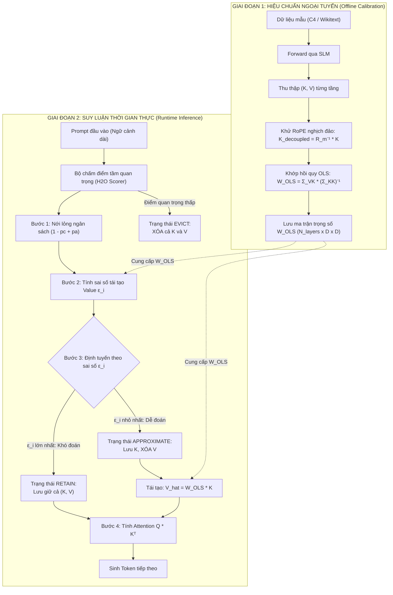
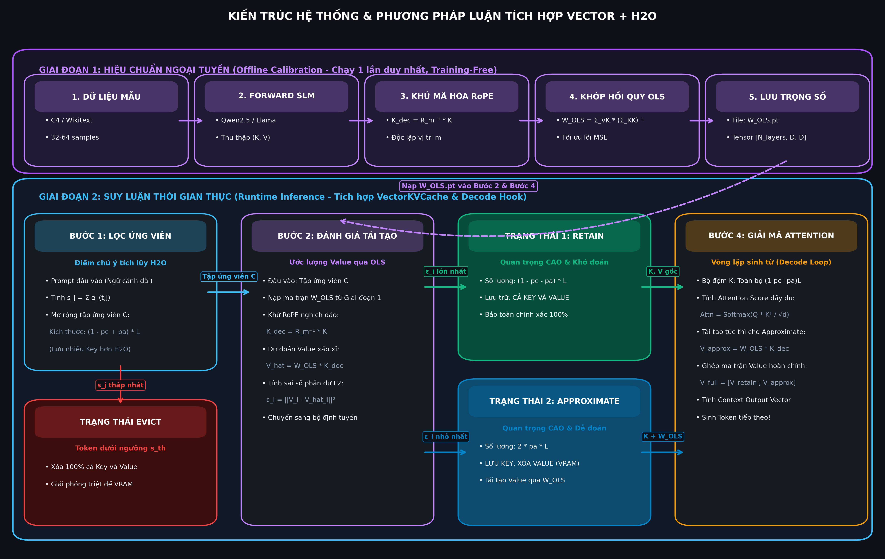

# BẢN ĐẶC TẢ ĐỀ TÀI ĐỒ ÁN PROJECT III (PROJECT SPECIFICATION)

---

## 1. THÔNG TIN CHUNG (GENERAL INFORMATION)

* **Tên đề tài (Tiếng Việt):** Nghiên cứu và Hiện thực Phương pháp Nén KV Cache Bất đối xứng Dựa trên Tính Cộng tuyến K–V cho Mô hình Ngôn ngữ Nhỏ (SLMs).
* **Tên đề tài (Tiếng Anh):** Research and Implementation of Asymmetric KV Cache Compression via K–V Collinearity for Small Language Models.
* **Mã học phần:** Project III (Đồ án chuyên ngành).
* **Đối tượng nghiên cứu:** 
  * Mô hình Ngôn ngữ Nhỏ (Small Language Models - SLMs): `Qwen2.5-1.5B-Instruct` và `Llama-3.2-1B-Instruct`.
  * Cơ chế bộ nhớ đệm Khóa - Giá trị (KV Cache) trong kiến trúc Transformer giải mã tự hồi quy (Autoregressive Decoder).
* **Phạm vi ứng dụng:** Suy luận ngữ cảnh dài (Long-Context Inference từ 4K đến 16K tokens) trên phần cứng hạn chế tài nguyên (Consumer GPU: RTX 3060/4060 6GB–12GB VRAM hoặc Google Colab T4 16GB).

---

## 2. BỐI CẢNH VÀ TÍNH CẤP THIẾT (BACKGROUND & MOTIVATION)

### 2.1. Nút thắt bộ nhớ KV Cache trên Mô hình Ngôn ngữ Nhỏ
Trong các ứng dụng suy luận cục bộ (On-device / Local LLMs), các mô hình SLM ($1\text{B} - 3\text{B}$ tham số) có kích thước trọng số rất nhỏ (chỉ chiếm từ $2\text{GB} - 6\text{GB}$ VRAM). Tuy nhiên, khi xử lý các chuỗi ngữ cảnh dài hoặc trò chuyện nhiều lượt:
* Kích thước KV Cache tăng tuyến tính theo chiều dài chuỗi: 
  $$\text{Memory}_{\text{KVCache}} = 2 \times 2 \times N_{\text{layer}} \times N_{\text{kv\_heads}} \times d_{\text{head}} \times L \quad (\text{bytes ở chuẩn FP16})$$
* Khi độ dài chuỗi $L \ge 16,000$ tokens, dung lượng KV Cache vượt quá kích thước trọng số mô hình, gây tràn bộ nhớ (Out-Of-Memory - OOM) và làm tắc nghẽn băng thông truy xuất bộ nhớ (Memory Bandwidth Bottleneck).

### 2.2. Hạn chế của các phương pháp cắt tỉa nhị phân (Binary Eviction)
Các phương pháp loại bỏ token hiện nay (như H2O, SnapKV, StreamingLLM) áp dụng cơ chế quyết định nhị phân:
* Token quan trọng $\rightarrow$ **Giữ lại $100\%$ cả $K$ và $V$**.
* Token ít quan trọng $\rightarrow$ **Xóa vĩnh viễn cả $K$ và $V$**.
* **Hậu quả:** Khi áp dụng tỷ lệ nén khắt khe (loại bỏ $70\% - 90\%$ cache), một lượng lớn thông tin ngữ cảnh bị vứt bỏ không thể đảo ngược, dẫn đến hiện tượng mô hình mất khả năng ghi nhớ chi tiết (Lost in the middle / Needle-in-a-Haystack failure).

### 2.3. Cơ sở khoa học mới của Đề tài (VECTOR Plug-in)
Đề tài dựa trên 2 phát hiện lý thuyết mang tính đột phá từ bài báo *A Simple Plug-in for Improving Eviction-Based KV Cache Compression*:
1. **Bất đối xứng độ nhạy (Asymmetric Sensitivity):** Vector Key ($K$) nằm trong hàm Softmax chứa số mũ $e^x$, nên sai số của $K$ bị khuếch đại theo hàm mũ; trong khi vector Value ($V$) chỉ lan truyền sai số tuyến tính. Do đó, việc bảo toàn $K$ có ý nghĩa sống còn hơn $V$.
2. **Tính cộng tuyến K–V (K–V Collinearity):** Do $K$ và $V$ cùng xuất phát từ biểu diễn ẩn $h$, giữa chúng tồn tại mối liên hệ tuyến tính chặt chẽ ($V \approx W_{\text{OLS}} K$) với hệ số xác định $R^2 \in [0.70, 0.94]$ theo bài báo gốc. Ta có thể xóa bỏ $V$ để tiết kiệm VRAM và tái tạo lại nó khi cần.
   * *Lưu ý thực nghiệm:* khoảng $R^2$ trên là số liệu của bài báo, chưa phải của đồ án. Đồ án sẽ đo $R^2$ trên tập held-out (Wikitext/C4) cho `Qwen2.5-1.5B-Instruct` theo từng layer/head. Nếu $R^2 < 0.70$, đồ án vẫn tiếp tục, báo cáo đây là một phát hiện, và bổ sung thí nghiệm $p_a$ theo từng layer.

---

## 3. MỤC TIÊU CỦA ĐỀ TÀI (PROJECT OBJECTIVES)

1. **Mục tiêu lý thuyết:**
   * Làm chủ bản chất toán học của cơ chế Attention, điểm nghẽn bộ nhớ KV Cache và tính chất bất đối xứng $K - V$.
   * Phân tích và chứng minh lý thuyết hoán đổi ngân sách bộ nhớ (Budget Swap) giúp giữ lại nhiều Key hơn mà không làm tăng dung lượng VRAM.
2. **Mục tiêu kỹ thuật & Hiện thực:**
   * Xây dựng mô-đun hiệu chuẩn ngoại tuyến (Offline Calibration) để tính ma trận OLS và khử mã hóa RoPE nghịch đảo ($R_m^{-1}$).
   * Thiết kế và cài đặt lớp `VectorKVCache` tương thích chuẩn giao diện `Cache` của Hugging Face Transformers.
   * Hiện thực hóa cơ chế định tuyến 3 trạng thái: **Retain** (Giữ cả K và V), **Approximate** (Giữ K, xóa V, tái tạo động), và **Evict** (Xóa cả K và V).
3. **Mục tiêu thực nghiệm:**
   * Nén giảm **$50\% - 75\%$** dung lượng bộ nhớ KV Cache của mô hình `Qwen2.5-1.5B-Instruct`.
   * Bảo toàn trên **$90\%$** độ chính xác so với Full Cache trên các tác vụ văn bản dài (LongBench) và truy xuất chi tiết (**Single-Needle & Multi-Needle NIAH**).
   * Vượt trội rõ rệt so với thuật toán nén nhị phân thuần túy (H2O Baseline) ở cùng một mức ngân sách VRAM.

---

## 4. KIẾN TRÚC HỆ THỐNG & PHƯƠNG PHÁP LUẬN (METHODOLOGY & ARCHITECTURE)

> **Hình 1:** *Sơ đồ kiến trúc hệ thống tổng thể gồm 2 giai đoạn: Hiệu chuẩn ngoại tuyến (Offline Calibration) và Suy luận thời gian thực (Runtime Inference).*

*(Bản vẽ đồ họa độ phân giải cao phục vụ thuyết minh / báo cáo)*

### Chi tiết các mô-đun chức năng:
1. **Module `RoPEDecoupler`:** Thực hiện biến đổi quay góc nghịch đảo trên Key ($K_{\text{decoupled}} = R_m^{-1} K$) trước khi hồi quy để ma trận $W_{\text{OLS}}$ độc lập với vị trí $m$.
2. **Module `OfflineCalibrator`:** Đọc dữ liệu calibration nhỏ (32–64 mẫu), thu thập activation tensor và giải hệ phương trình OLS qua `torch.linalg.lstsq`.
3. **Module `VectorKVCache` (Lớp quản lý bộ nhớ đệm):**
   * Kế thừa từ `transformers.cache_utils.Cache`.
   * Quản lý hai danh sách index: `retain_indices` và `approx_indices`.
   * Bộ nhớ chỉ cấp phát VRAM vật lý cho tensor $K$ của cả hai nhóm và tensor $V$ của nhóm retain.
4. **Module `DynamicAttentionHook`:** Khi vòng lặp sinh từ giải mã (Decode Step), hook tự động nhân $W_{\text{OLS}} \cdot K$ cho các token thuộc nhóm approximate ngay trước phép nhân ma trận giá trị chú ý.

---

## 5. KẾ HOẠCH THỰC NGHIỆM & ĐÁNH GIÁ (EVALUATION PLAN)

### 5.1. Thiết lập Thực nghiệm
* **Mô hình thí nghiệm:** `Qwen/Qwen2.5-1.5B-Instruct` (mặc định) và `meta-llama/Llama-3.2-1B-Instruct` (mở rộng).
* **Môi trường:** Python 3.10+, PyTorch 2.3+, Hugging Face `transformers`, `accelerate`.
* **Phần cứng:** Thử nghiệm trên GPU cục bộ (RTX 3060/4060) hoặc Google Colab (Tesla T4 16GB).

### 5.2. Các Phương pháp Đối chuẩn (Baselines)
1. **Full FP16 KV Cache (Mốc trần chất lượng):** Giữ nguyên $100\%$ bộ nhớ không nén.
2. **Uniform Quantization (INT4/INT8):** Lượng tử hóa toàn bộ cache theo chuẩn thông thường.
3. **H2O (Heavy Hitter Oracle - Binary Eviction Baseline):** Tỉa nhị phân thuần túy dựa trên cumulative attention score.
4. **H2O + VECTOR Plug-in (Phương pháp đề xuất của đồ án):** Cơ chế nén 3 ngả hoán đổi ngân sách.

### 5.3. Các mức Ngân sách Thử nghiệm (Cache Budgets)
Thử nghiệm trên 4 tỷ lệ nén bộ nhớ ($p_c$):
* $p_c = 0\%$ (Full Cache)
* $p_c = 50\%$ (Giữ lại $50\%$ bộ nhớ)
* $p_c = 75\%$ (Giữ lại $25\%$ bộ nhớ - Ngân sách khắt khe)
* $p_c = 85\%$ (Giữ lại $15\%$ bộ nhớ - Ngân sách cực hạn)

### 5.4. Tập dữ liệu & Chỉ số Đo lường (Datasets & Metrics)

| Khía cạnh | Bài toán / Tập dữ liệu | Chỉ số đo lường (Metrics) | Mục tiêu kỳ vọng |
| :--- | :--- | :--- | :--- |
| **Tiết kiệm Bộ nhớ** | Đo đạc trên GPU: prefill 8K tokens + decode 128 tokens | **(Chính)** Bộ nhớ KV cache lâu dài (MB, đếm mọi tensor cache giữ) và Cache Compression Ratio (x) so với Full. **(Phụ)** Peak VRAM (MB), báo cáo nguyên trạng, tách phần trọng số / attention / KV | Bộ nhớ KV cache giảm $\ge 60\%$ so với Full ở $p_c \ge 75\%$; VECTOR không vượt H2O ở cùng ngân sách; Peak VRAM không kém H2O |
| **Tốc độ Suy luận** | Vòng lặp sinh 128 tokens | TTFT (ms), Throughput (tokens/second) | Throughput không giảm quá $5\%$ so với H2O gốc |
| **Truy xuất Đơn kim** | **Single-Needle NIAH** (4K – 16K context) | Retrieval Accuracy (%) hiển thị qua Heatmap | Accuracy đạt $\ge 95\%$ ở mức nén $75\%$, xóa bỏ điểm mù (blind spots) của H2O |
| **Truy xuất Đa kim** | **Multi-Needle NIAH** (3 – 5 cây kim rải rác) | Multi-key Retrieval Recall & Accuracy (%) | Khắc phục hoàn toàn tình trạng mất dữ kiện; vượt trội H2O gốc từ $15\% - 30\%$ ở mức nén cao ($p_c \ge 75\%$) |
| **Đọc hiểu Dài** | **LongBench** (NarrativeQA, Qasper) | F1 Score, ROUGE-L | Vượt trội hơn H2O gốc từ $5\% - 15\%$ F1 |
| **Suy luận Toán học** | **GSM8K** (200 câu hỏi) | Exact Match Accuracy (%) | Giữ nguyên $\ge 90\%$ điểm số của Full Cache |

---

## 6. LỘ TRÌNH THỰC HIỆN 15 TUẦN (15-WEEK PROJECT TIMELINE)

| Tuần | Giai đoạn | Nội dung công việc cụ thể | Sản phẩm / Kết quả đạt được |
| :---: | :--- | :--- | :--- |
| **1 – 2** | Khởi động & Nghiên cứu | • Nghiên cứu chi tiết paper VECTOR và H2O. • Phân tích cấu trúc module `transformers.Cache`. | Đề cương chi tiết, môi trường ảo PyTorch sẵn sàng. |
| **3 – 4** | Xây dựng Baseline | • Cài đặt baseline Full FP16 và H2O Binary Eviction. • Viết script đánh giá Single-Needle & Multi-Needle NIAH và đo VRAM (`torch.cuda.max_memory_allocated`). | Script baseline đo đạc được Peak VRAM và điểm NIAH của H2O. |
| **5 – 6** | Hiệu chuẩn Ngoại tuyến | • Hiện thực thuật toán khử RoPE nghịch đảo ($R_m^{-1}$). • Viết script OLS thu thập dữ liệu trên C4/Wikitext và tính ma trận $W_{\text{OLS}}$. | Checkpoint ma trận $W_{\text{OLS}}$ cho từng tầng của `Qwen2.5-1.5B`. |
| **7 – 8** | Hiện thực Lớp Cache VECTOR | • Cài đặt lớp `VectorKVCache` hỗ trợ lưu trữ bất đối xứng. • Viết logic 3 bước: nới lỏng ngân sách, tính $\varepsilon_i$, phân nhóm Retain/Approx/Evict. | Unit test chạy pass quá trình prefill và sinh từ không lỗi tensor shape. |
| **9 – 10** | Tích hợp & Tối ưu hóa | • Tích hợp hook tái tạo $V$ tức thì trong vòng lặp giải mã. • Tinh chỉnh siêu tham số tỷ lệ xấp xỉ $p_a \in [0.1, 0.4]$. | Hệ thống hoàn chỉnh chạy trơn tru từ đầu đến cuối (End-to-End). |
| **11 – 12** | Thực nghiệm Toàn diện | • Chạy benchmark so sánh: Full vs H2O vs H2O+VECTOR trên 4 mức ngân sách. • Thu thập log VRAM, Throughput, NIAH Heatmap (Single/Multi-Needle), GSM8K. | Bảng số liệu thô và các đồ thị biểu diễn kết quả. |
| **13 – 14** | Viết Báo cáo Đồ án | • Viết tài liệu báo cáo đồ án Project III theo mẫu chuẩn của nhà trường. • Vẽ sơ đồ kiến trúc, phân tích bảng số liệu thực nghiệm. | Bản thảo báo cáo hoàn chỉnh (Bao gồm chương lý thuyết, giải pháp, thực nghiệm). |
| **15** | Hoàn thiện & Bảo vệ | • Đóng gói mã nguồn lên GitHub, viết README chi tiết. • Làm slide thuyết trình và chuẩn bị demo sản phẩm. | Slide thuyết trình, video/demo thực nghiệm sẵn sàng bảo vệ. |

---

## 7. DỰ KIẾN KẾT QUẢ ĐẦU RA (DELIVERABLES)

1. **Báo cáo Đồ án Project III (PDF):** Cấu trúc bài bản ~40–60 trang theo chuẩn học thuật (Tổng quan, Cơ sở lý thuyết, Phương pháp đề xuất, Thực nghiệm & Thảo luận, Kết luận).
2. **Kho mã nguồn hoàn chỉnh (GitHub Repository):**
   * Module `vector_cache/`: Mã nguồn lớp cache và hook tái tạo.
   * Module `calibration/`: Script tính ma trận OLS tự động.
   * Module `evaluation/`: Bộ script chạy thực nghiệm đo VRAM, Throughput, NIAH (Single/Multi-Needle), LongBench.
   * File `README.md` hướng dẫn cài đặt và tái lập kết quả chỉ với 1 lệnh chạy.
3. **Bộ biểu đồ & Trực quan hóa:**
   * Biểu đồ nhiệt (Heatmap) thể hiện tỷ lệ tìm kiếm thành công "Single-Needle & Multi-Needle NIAH" theo độ dài ngữ cảnh và vị trí độ sâu.
   * Biểu đồ Pareto (Trade-off) giữa Tỷ lệ nén bộ nhớ (%) và Điểm chất lượng (F1/Accuracy).

---

## 8. LỊCH SỬ THAY ĐỔI ĐẶC TẢ (CHANGELOG)

| Ngày | Mục | Thay đổi | Lý do |
| :--- | :--- | :--- | :--- |
| 2026-10-24 | §5.4 Tiết kiệm Bộ nhớ (D2) | Chỉ số chính đổi từ Peak VRAM sang bộ nhớ KV cache lâu dài; Peak VRAM thành chỉ số phụ | Ở 8K, KV cache (~224 MB) nhỏ hơn nhiều so với trọng số (~3 GB) và ma trận attention prefill; Peak VRAM không phản ánh tác dụng nén. Xem `tasks/roadmap.md` §1 |
| 2026-10-24 | §2.3 Tính cộng tuyến K–V (D4) | Ghi rõ $R^2 \in [0.70, 0.94]$ là số của bài báo; đồ án tự đo trên held-out, tiếp tục và báo cáo nếu $R^2 < 0.70$ | W_OLS hiện tại có $R^2$ trung bình 0.517, 28/28 layer < 0.70 (`logs/review_roadmap_r2.log`) |
