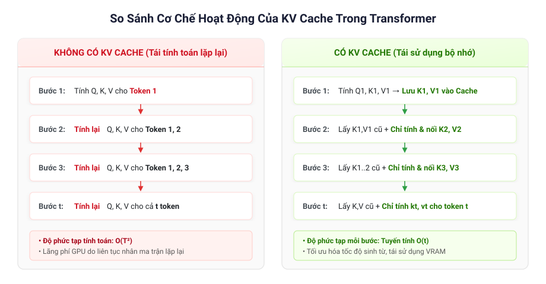
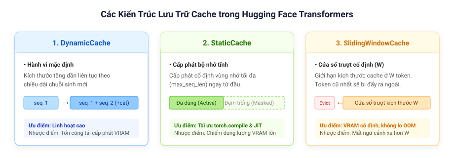

# Cơ Chế Hoạt Động của KV Cache trong Transformer

Hãy hình dung bạn đang trò chuyện với một người bạn, nhưng thay vì ghi nhớ những gì cả hai vừa trao đổi, người đó lại phải bắt đầu nghe và nhớ lại từ đầu mỗi khi bạn đưa ra câu trả lời mới. Điều này chắc chắn sẽ cực kỳ chậm chạp và kém hiệu quả.

Bạn có thể áp dụng tương tự sự so sánh này cho các mô hình Transformer sinh từ tự hồi quy (autoregressive models). Quá trình sinh tự hồi quy dự đoán văn bản theo từng token một cách tuần tự. Mỗi token mới được dự đoán đều phụ thuộc vào toàn bộ ngữ cảnh của câu nhắc (prompt) và các token đã sinh ra trước đó.

---

## 1. Điểm Nghẽn của Quá Trình Sinh Tự Hồi Quy (The Autoregressive Bottleneck)

Để dự đoán token thứ $1000$:
- Mô hình cần thông tin ngữ cảnh từ toàn bộ $999$ token đứng trước.
- Thông tin này được biểu diễn dưới dạng các phép nhân ma trận qua các lớp Multi-Head Attention trên biểu diễn của các token.

Để dự đoán tiếp token thứ $1001$:
- Bạn lại cần chính xác thông tin từ $999$ token trước đó **cộng thêm** biểu diễn của token thứ $1000$ vừa sinh ra.
- Nếu không có bộ nhớ đệm (cache), mô hình buộc phải tính toán lại từ đầu toàn bộ các biểu diễn Key và Value cho cả $1000$ token cũ!

**Bộ nhớ đệm Khóa-Giá trị (Key-Value / KV Cache)** loại bỏ sự lãng phí này bằng cách lưu trữ các cặp vector ($K, V$) được sinh ra từ các tầng chú ý của những token đã xử lý trước đó. Các cặp $K, V$ được lưu trữ sẽ được truy xuất trực tiếp từ bộ nhớ VRAM và tái sử dụng cho các bước sinh tiếp theo mà không cần phải tính toán lại.



> [!WARNING]
> Cơ chế Caching **chỉ được sử dụng trong giai đoạn suy luận (inference / generation)**. Tuyệt đối không bật caching trong quá trình huấn luyện (training) vì nó sẽ gây sai lệch gradient và phát sinh các lỗi không mong muốn.

---

## 2. Công Thức Toán Học & Ma Trận Attention

### Cơ Chế Scaled Dot-Product Attention

Với kích thước batch $b$, số lượng attention head $h$, chiều dài chuỗi hiện tại $T$, và số chiều của mỗi head $d_{\text{head}}$, cơ chế Scaled Dot-Product Attention được định nghĩa như sau:

$$
\text{Attention}(Q, K, V) = \text{softmax}\left( \frac{Q K^\top}{\sqrt{d_{\text{head}}}} + \text{mask} \right) V
$$

Trong đó:
- $Q, K, V \in \mathbb{R}^{b \times h \times T \times d_{\text{head}}}$ là các phép chiếu tuyến tính từ trạng thái ẩn của các token.
- Mặt nạ nhân quả (`causal mask`) ngăn không cho token ở vị trí hiện tại nhìn thấy các token trong tương lai ($> t$).

### Tận Dụng Tính Bất Biến Nhân Quả (Causal Invariance)

Trong kiến trúc Transformer Decoder tự hồi quy, một khi token quá khứ $i$ ($i < t$) đã được xử lý, vector key $k_i$ và vector value $v_i$ của nó **không bao giờ thay đổi** đối với các token trong tương lai. Do đó, toàn bộ các vector key trong quá khứ ($K_{\text{past}}$) và value trong quá khứ ($V_{\text{past}}$) có thể được lưu trữ vĩnh viễn trong bộ nhớ đệm:

$$
\text{Attention}\left(q_t, \left[\underbrace{k_1, k_2, \dots, k_{t-1}}_{\text{đã lưu trong } K_{\text{past}}}, k_t\right], \left[\underbrace{v_1, v_2, \dots, v_{t-1}}_{\text{đã lưu trong } V_{\text{past}}}, v_t\right]\right)
$$

Tại bước giải mã thứ $t$:
1. Mô hình chỉ cần tính vector query $q_t$, key $k_t$, và value $v_t$ **duy nhất cho token hiện tại**.
2. Nối thêm vector $k_t$ và $v_t$ mới vào bộ nhớ đệm:
   $$
   K_{\text{cache}} \leftarrow \text{concat}(K_{\text{past}}, k_t), \quad V_{\text{cache}} \leftarrow \text{concat}(V_{\text{past}}, v_t)
   $$
3. Tính toán attention bằng cách cho vector query đơn lẻ $q_t \in \mathbb{R}^{b \times h \times 1 \times d_{\text{head}}}$ nhân với toàn bộ $K_{\text{cache}}$ và $V_{\text{cache}}$ đã tích lũy.

> [!NOTE]
> Phép tính Attention diễn ra độc lập ở từng tầng Transformer, do đó bộ nhớ đệm KV Cache cũng được duy trì độc lập trên **từng tầng riêng biệt (per-layer basis)**.

---

## 3. So Sánh Độ Phức Tạp Tính Toán (Complexity Comparison)

| Tiêu chí | Không có KV Cache | Có KV Cache |
| :--- | :--- | :--- |
| **Phép tính mỗi bước $t$** | Tính toán lại $K, V$ cho toàn bộ $1 \dots t$ token | Chỉ tính $K, V$ cho duy nhất token hiện tại $t$ |
| **FLOPs trên mỗi token** | $\mathcal{O}(t)$ phép chiếu + attention cho mỗi token | $\mathcal{O}(1)$ phép chiếu + $\mathcal{O}(t)$ tích vô hướng attention |
| **Tổng chi phí toàn chuỗi** | $\mathcal{O}(T^2)$ phép chiếu ma trận | Giảm mạnh khối lượng tính toán phép chiếu ma trận |
| **Dung lượng bộ nhớ (VRAM)** | Thấp (chỉ lưu tensor kích hoạt của một lượt forward) | Tốn bộ nhớ: $\mathcal{O}(b \cdot N_{\text{layer}} \cdot N_{\text{head}} \cdot T \cdot d_{\text{head}})$ |

---

## 4. Giao Diện `Cache` trong Thư Viện Hugging Face

Trong thư viện `transformers` của Hugging Face, cơ chế caching được chuẩn hóa thông qua lớp cơ sở [`Cache`](https://huggingface.co/docs/transformers/main/en/internal/generation_utils#transformers.Cache).

Một giao diện cache cơ bản nhận vào tensor key và value của token hiện tại, sau đó trả về toàn bộ chuỗi $K$ và $V$ đã được cập nhật cho một tầng cụ thể:

```python
# Minh họa quá trình thực thi bên trong một tầng decoder:
new_K, new_V = cache.update(key_states=k_t, value_states=v_t, layer_idx=layer_idx)
attn_output = attention_forward(query_states=q_t, key_states=new_K, value_states=new_V)
```

### Các Yếu Tố Kỹ Thuật Quan Trọng Khi Dùng Cache

1. **Kích Thước Tensor (Tensor Dimensions):**  
   Module Attention kết hợp $K, V$ quá khứ với $k_t, v_t$ hiện tại. Ma trận trọng số chú ý thu được sẽ có kích thước:
   $$\left(\text{batch\_size}, \text{num\_heads}, \text{new\_tokens\_length}, \text{past\_kv\_length} + \text{new\_tokens\_length}\right)$$
   Trong quá trình sinh tự hồi quy từng token một, $\text{new\_tokens\_length} = 1$.

2. **Căn Chỉnh Mặt Nạ Chú Ý (Attention Mask Alignment):**  
   Khi gọi phương thức `model.forward()` thủ công theo từng bước, kích thước của tensor `attention_mask` bắt buộc phải khớp với tổng độ dài của cả token cũ và mới:
   $$\text{shape} = \left(\text{batch\_size}, \text{past\_kv\_length} + \text{new\_tokens\_length}\right)$$
   Mặc dù việc này được xử lý tự động trong hàm [`generate()`](https://huggingface.co/docs/transformers/main/en/main_classes/text_generation#transformers.GenerationMixin.generate), nhưng nếu bạn tự viết vòng lặp sinh từ tùy chỉnh, bạn cần chủ động nối thêm giá trị $1$ vào mặt nạ ở mỗi bước sinh.

---

## 5. Các Kiến Trúc Lưu Trữ Cache (Cache Storage Implementations)

Bộ nhớ cache được cấu trúc như một danh sách các tầng, trong đó mỗi tầng lưu trữ một cặp tensor Key và Value:

$$\text{Kích thước: } \left[\text{batch\_size}, \text{num\_heads}, \text{seq\_len}, \text{head\_dim}\right]$$

Các lớp Cache khác nhau sẽ quản lý bộ nhớ và sự gia tăng độ dài chuỗi theo các cách khác nhau:



### 1. `DynamicCache`
- Hành vi mặc định trong Hugging Face Transformers.
- Kích thước mở rộng liên tục theo từng bước sinh bằng phép nối `torch.cat`:
  ```python
  cache.layers[idx].keys = torch.cat([cache.layers[idx].keys, key_states], dim=-2)
  cache.layers[idx].values = torch.cat([cache.layers[idx].values, value_states], dim=-2)
  ```
- Rất linh hoạt nhưng phát sinh chi phí tái cấp phát bộ nhớ (memory reallocation) liên tục trong GPU.

### 2. `StaticCache`
- Cấp phát sẵn một vùng nhớ cố định cho độ dài chuỗi tối đa ngay từ đầu.
- Tránh được việc liên tục cấp phát lại bộ nhớ trong VRAM.
- Hoàn toàn tương thích với CUDA Graphs và `torch.compile` để tối ưu hóa hiệu năng tính toán.

### 3. `StaticSlidingWindowCache`
- Giới hạn độ dài chuỗi trong một cửa sổ trượt kích thước cố định $W$.
- Khi cửa sổ đầy, các token cũ nhất sẽ tự động bị đẩy ra ngoài (evicted) khi có token mới được thêm vào.

---

## 6. Ví Dụ Triển Khai Mã Nguồn Hoàn Chỉnh (End-to-End Code Example)

Đoạn mã Python dưới đây minh họa cách tự xây dựng một vòng lặp sinh từ tự hồi quy tùy chỉnh sử dụng [`DynamicCache`](https://huggingface.co/docs/transformers/main/en/internal/generation_utils#transformers.DynamicCache):

```python
import torch
from accelerate import Accelerator
from transformers import AutoModelForCausalLM, AutoTokenizer, DynamicCache

# 1. Khởi tạo thiết bị và tải mô hình
device = Accelerator().device
model_id = "meta-llama/Llama-2-7b-chat-hf"

tokenizer = AutoTokenizer.from_pretrained(model_id)
model = AutoModelForCausalLM.from_pretrained(
    model_id,
    torch_dtype=torch.bfloat16,
    device_map=device
)

# 2. Khởi tạo bộ nhớ đệm KV Cache động
past_key_values = DynamicCache()

# 3. Chuẩn bị câu nhắc (prompt) với template chat
messages = [{"role": "user", "content": "Hello, what's your name?"}]
inputs = tokenizer.apply_chat_template(
    messages,
    add_generation_prompt=True,
    return_tensors="pt",
    return_dict=True
).to(model.device)

generated_ids = inputs.input_ids
max_new_tokens = 10

# 4. Vòng lặp giải mã tự hồi quy thủ công
for step in range(max_new_tokens):
    # Lượt forward: truyền past_key_values và bật use_cache=True
    outputs = model(
        **inputs,
        past_key_values=past_key_values,
        use_cache=True
    )
    
    # Lấy mẫu tham lam (greedy sampling): chọn token có xác suất cao nhất tại vị trí cuối cùng
    next_token_id = outputs.logits[:, -1:].argmax(dim=-1)
    generated_ids = torch.cat([generated_ids, next_token_id], dim=-1)

    # Cập nhật attention_mask để bao gồm cả token mới vừa sinh (+1 cột)
    attention_mask = inputs["attention_mask"]
    new_mask_col = attention_mask.new_ones((attention_mask.shape[0], 1))
    attention_mask = torch.cat([attention_mask, new_mask_col], dim=-1)

    # Chuẩn bị input cho bước sinh tiếp theo (chỉ truyền token mới duy nhất!)
    inputs = {
        "input_ids": next_token_id,
        "attention_mask": attention_mask
    }

# 5. Giải mã và in chuỗi kết quả hoàn chỉnh
response_text = tokenizer.batch_decode(generated_ids, skip_special_tokens=True)[0]
print(response_text)
```

### Kết Quả Đầu Ra Mong Đợi (Expected Output)

```text
[INST] Hello, what's your name? [/INST] Hello! My name is LLaMA,
```
