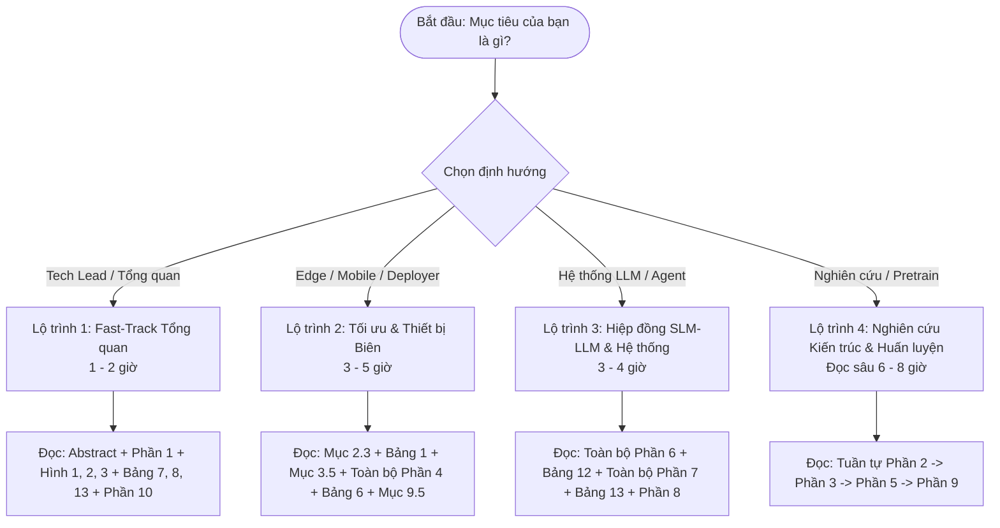
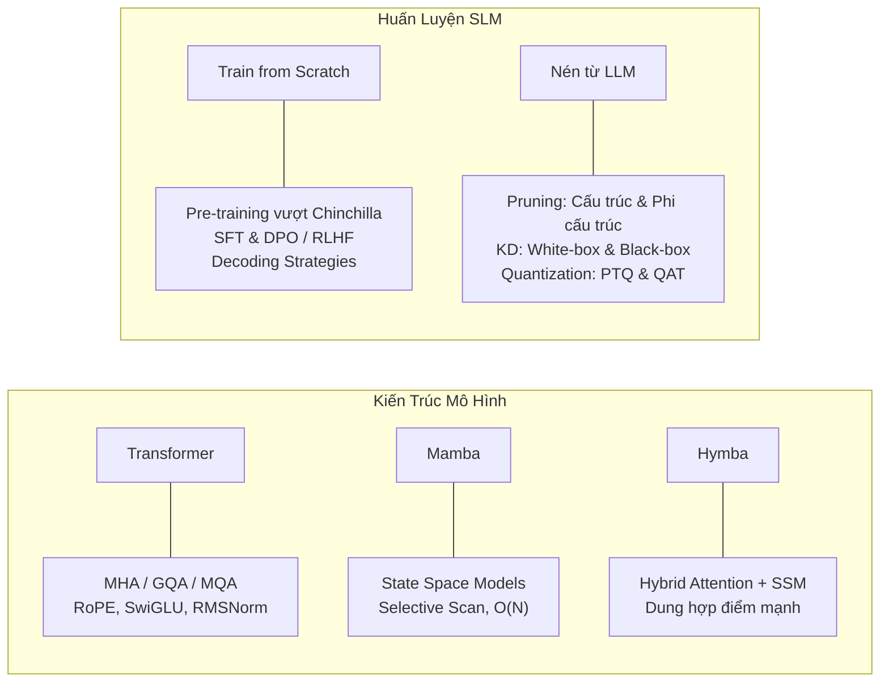
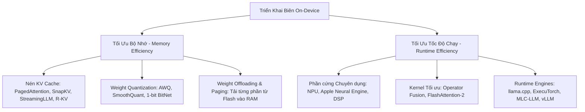
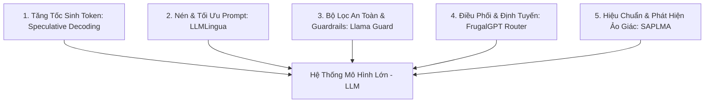
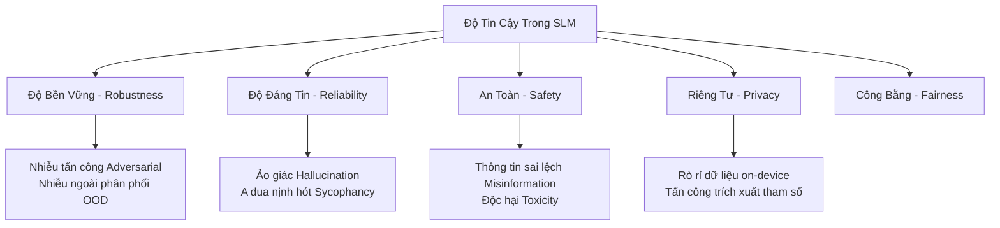

# Khảo sát Toàn diện về Mô hình Ngôn ngữ Nhỏ (Small Language Models - SLMs) trong Kỷ nguyên Mô hình Ngôn ngữ Lớn (LLMs)
## Kỹ thuật, Cải tiến, Ứng dụng, Sự hiệp đồng với LLM và Độ tin cậy

> **Tên bài báo gốc:** *A Comprehensive Survey of Small Language Models in the Era of Large Language Models: Techniques, Enhancements, Applications, Collaboration with LLMs, and Trustworthiness*  
> **Tác giả:** Fali Wang, Zhiwei Zhang, Xianren Zhang, Zongyu Wu, TzuHao Mo, Qiuhao Lu, Wanjing Wang, Rui Li, Junjie Xu, Xianfeng Tang, Qi He, Yao Ma, Ming Huang, Suhang Wang*  
> **Đơn vị công tác:** The Pennsylvania State University, University of Pennsylvania, UTHealth Houston, Amazon, Rensselaer Polytechnic Institute  
> **Độ dài bài báo:** 78 trang (Bao gồm khảo sát lý thuyết, thực nghiệm, hệ thống hóa hơn 400 công trình nghiên cứu và tài liệu tham khảo)  
> **Tài liệu gốc:** [PDF đính kèm trong thư mục docs/papers](file:///d:/MyProject/ProjectIII/docs/papers/A%20Comprehensive%20Survey%20of%20Small%20Language%20Models%20in%20the%20Era%20of%20Large%20Language%20Models%20-%20Techniques%2C%20Enhancements%2C%20Applications%2C%20Collaboration%20with%20LLMs%2C%20and%20Trustworthiness.pdf)

---

## Mục lục Toàn văn

- [Lộ trình Đọc Paper (Reading Roadmap)](#lộ-trình-đọc-paper-reading-roadmap)
  - [Lộ trình 1: Fast-Track cho Quản lý & Tech Lead (1 – 2 giờ)](#lộ-trình-1-fast-track-cho-quản-lý--tech-lead-1--2-giờ)
  - [Lộ trình 2: Kỹ sư Triển khai Biên & Hệ thống (Edge AI & System Engineers) (3 – 5 giờ)](#lộ-trình-2-kỹ-sư-triển-khai-biên--hệ-thống-edge-ai--system-engineers-3--5-giờ)
  - [Lộ trình 3: Kiến trúc sư Hệ thống LLM & Ứng dụng (LLM Systems & Agents) (3 – 4 giờ)](#lộ-trình-3-kiến-trúc-sư-hệ-thống-llm--ứng-dụng-llm-systems--agents-3--4-giờ)
  - [Lộ trình 4: Nhà Nghiên cứu & Huấn luyện Mô hình (AI Researchers / Model Pretrainers) (Đọc Sâu Toàn diện)](#lộ-trình-4-nhà-nghiên-cứu--huấn-luyện-mô-hình-ai-researchers--model-pretrainers-đọc-sâu-toàn-diện)
- [Tóm tắt Điều hành (Executive Summary)](#tóm-tắt-điều-hành-executive-summary)
- [Phần 1: Giới thiệu & Động lực Phát triển SLM](#phần-1-giới-thiệu--động-lực-phát-triển-slm)
  - [1.1 Bối cảnh lịch sử và Nút thắt của LLM](#11-bối-cảnh-lịch-sử-và-nút-thắt-của-llm)
  - [1.2 Định nghĩa và Phạm vi của SLM](#12-định-nghĩa-và-phạm-vi-của-slm)
  - [1.3 Xu hướng thực tế trên cộng đồng mã nguồn mở](#13-xu-hướng-thực-tế-trên-cộng-đồng-mã-nguồn-mở)
- [Phần 2: Các Khái niệm Nền tảng trong Xây dựng SLM](#phần-2-các-khái-niệm-nền-tảng-trong-xây-dựng-slm)
  - [2.1 Kiến trúc mô hình: Transformer, Mamba và Hymba](#21-kiến-trúc-mô-hình-transformer-mamba-và-hymba)
  - [2.2 Huấn luyện SLM từ đầu (Training from Scratch)](#22-huấn-luyện-slm-từ-đầu-training-from-scratch)
  - [2.3 Thu được SLM từ LLM (Nén & Chuyển giao)](#23-thu-được-slm-từ-llm-nén--chuyển-giao)
- [Phần 3: Các Chiến lược Nâng cao Hiệu năng SLM](#phần-3-các-chiến-lược-nâng-cao-hiệu-năng-slm)
  - [3.1 Phương pháp huấn luyện cải tiến từ đầu](#31-phương-pháp-huấn-luyện-cải-tiến-từ-đầu)
  - [3.2 Supervised Fine-Tuning (SFT) & Căn chỉnh](#32-supervised-fine-tuning-sft--căn-chỉnh)
  - [3.3 Tối ưu Chất lượng Dữ liệu trong Chưng cất Tri thức](#33-tối-ưu-chất-lượng-dữ-liệu-trong-chưng-cất-tri-thức)
  - [3.4 Kỹ thuật Chưng cất Nâng cao (Distillation Techniques)](#34-kỹ-thuật-chưng-cất-nâng-cao-distillation-techniques)
  - [3.5 Nâng cấp Hiệu năng qua Lượng tử hóa](#35-nâng-cấp-hiệu-năng-qua-lượng-tử-hóa)
  - [3.6 Ứng dụng các Kỹ thuật LLM cho SLM](#36-ứng-dụng-các-kỹ-thuật-llm-cho-slm)
- [Phần 4: Ứng dụng Thực tiễn và Triển khai Thiết bị Biên (Mobile & Edge)](#phần-4-ứng-dụng-thực-tiễn-và-triển-khai-thiết-bị-biên-mobile--edge)
  - [4.1 Các ứng dụng theo tác vụ chuyên biệt](#41-các-ứng-dụng-theo-tác-vụ-chuyên-biệt)
  - [4.2 Triển khai trên Thiết bị Di động và Thiết bị Biên](#42-triển-khai-trên-thiết-bị-di-động-và-thiết-bị-biên)
- [Phần 5: Phân loại SLM Đa dụng và SLM Chuyên ngành](#phần-5-phân-loại-slm-đa-dụng-và-slm-chuyên-ngành)
  - [5.1 Các dòng SLM Đa dụng Tiêu biểu (Generic-domain SLMs)](#51-các-dòng-slm-đa-dụng-tiêu-biểu-generic-domain-slms)
  - [5.2 Bảng so sánh Hiệu năng Benchmark của các SLM](#52-bảng-so-sánh-hiệu-năng-benchmark-của-các-slm)
  - [5.3 Các dòng SLM Chuyên ngành (Domain-specific SLMs)](#53-các-dòng-slm-chuyên-ngành-domain-specific-slms)
- [Phần 6: SLM Hỗ trợ LLM (SLMs for LLMs)](#phần-6-slm-hỗ-trợ-llm-slms-for-llms)
  - [6.1 Hỗ trợ Quá trình Sinh Suy luận Đáng tin cậy & Tăng tốc](#61-hỗ-trợ-quá-trình-sinh-suy-luận-đáng-tin-cậy--tăng-tốc)
  - [6.2 Trích xuất, Nén và Tối ưu Hóa Prompt](#62-trích-xuất-nén-và-tối-ưu-hóa-prompt)
  - [6.3 Tinh chỉnh và Căn chỉnh LLM (Fine-tuning Proxy)](#63-tinh-chỉnh-và-căn-chỉnh-llm-fine-tuning-proxy)
  - [6.4 Điều phối Luồng Ứng dụng & Routing](#64-điều-phối-luồng-ứng-dụng--routing)
  - [6.5 Đảm bảo An toàn & Kiểm duyệt (Guardrails)](#65-đảm-bảo-an-toàn--kiểm-duyệt-guardrails)
  - [6.6 Đánh giá LLM Hiệu quả Chi phí](#66-đánh-giá-llm-hiệu-quả-chi-phí)
- [Phần 7: Hiệp đồng giữa SLM và LLM (Synergy)](#phần-7-hiệp-đồng-giữa-slm-và-llm-synergy)
  - [7.1 Hiệp đồng Đám mây - Biên (Cloud-Edge Synergy)](#71-hiệp-đồng-đám-mây---biên-cloud-edge-synergy)
  - [7.2 Hiệp đồng Định hướng Tác vụ (Task-Centric Synergy)](#72-hiệp-đồng-định-hướng-tác-vụ-task-centric-synergy)
- [Phần 8: Độ Tin cậy và Đạo đức trong SLM (Trustworthiness)](#phần-8-độ-tin-cậy-và-đạo-đức-trong-slm-trustworthiness)
- [Phần 9: Các Hướng Nghiên cứu Tương lai (Future Directions)](#phần-9-các-hướng-nghiên-cứu-tương-lai-future-directions)
- [Phần 10: Kết luận](#phần-10-kết-luận)

---

## Lộ trình Đọc Paper (Reading Roadmap)

Do khảo sát này có quy mô lên tới 78 trang và đề cập đến hơn 450 công trình khoa học trải dài trên nhiều khía cạnh kỹ thuật, việc đọc tuần tự từ trang 1 đến trang 78 có thể gây quá tải thông tin. Dưới đây là 4 lộ trình đọc được phân tầng theo mục tiêu và vai trò thực tế:



### Lộ trình 1: Fast-Track cho Quản lý & Tech Lead (1 – 2 giờ)
- **Mục tiêu:** Hiểu rõ tại sao doanh nghiệp cần SLM thay vì chỉ dựa vào OpenAI/Anthropic APIs, nắm bắt bức tranh toàn cảnh về hiệu năng và chi phí.
- **Các phần cần đọc:**
  1. **Abstract & Phần 1 (Giới thiệu):** Động lực kinh tế, chi phí inference, quyền riêng tư, và số liệu download trên Hugging Face (Hình 2: SLM chiếm lượng tải áp đảo so với model khổng lồ).
  2. **Bảng 7 & Bảng 8 (Trang 34 & 38):** Tổng quan các mô hình SLM thịnh hành nhất (Llama 3.2 1B/3B, Qwen 2.5 0.5B-3B, Gemma 2 2B, Phi-3.5) và tương quan điểm số benchmark.
  3. **Bảng 13 & Phần 7:** Mô hình kiến trúc hiệp đồng Cloud-Edge (xử lý tác vụ nhẹ tại máy người dùng, chỉ đẩy tác vụ khó lên Cloud).
  4. **Phần 10 (Kết luận):** Tóm lược các nhận định cốt lõi.
- **Câu hỏi phản tư:** Khi nào công ty chúng ta nên dùng SLM tự host và khi nào nên dùng LLM trả phí qua API?

### Lộ trình 2: Kỹ sư Triển khai Biên & Hệ thống (Edge AI & System Engineers) (3 – 5 giờ)
- **Mục tiêu:** Nắm vững các kỹ thuật nén mô hình, cắt giảm KV Cache, tối ưu phần cứng (NPU/APU), quantization và các runtime engine on-device.
- **Các phần cần đọc:**
  1. **Mục 2.3 (Thu được SLM từ LLM):** Cơ chế cắt tỉa (Pruning phi cấu trúc vs cấu trúc), Lượng tử hóa (PTQ vs QAT, INT4, FP8, BitNet 1.58-bit).
  2. **Bảng 1 (Trang 13) & Mục 3.5:** Các kỹ thuật nén hiện đại nhất (SmoothQuant, BiLLM, PB-LLM, OneBit, BitNet b1.58).
  3. **Phần 4.2 (Triển khai trên Mobile và Thiết bị Biên):**
     - *Tối ưu bộ nhớ:* Cơ chế nén KV Cache (StreamingLLM, PagedAttention, SnapKV, R-KV, GEAR, DMC).
     - *Tối ưu thời gian chạy:* NPU acceleration, Operator fusion, llama.cpp, ExecuTorch, Apple MLX, vLLM.
  4. **Bảng 6 (Trang 30):** Bảng tổng hợp các kỹ thuật On-device Deployment.
  5. **Mục 9.5:** Xu hướng lượng tử hóa siêu thấp (sub-bit) và on-device continual learning.
- **Thực hành gợi ý:** Thử nghiệm chạy Llama-3.2-1B hoặc Qwen-2.5-1.5B qua `llama.cpp` hoặc `ExecuTorch` trên thiết bị cá nhân bằng định dạng GGUF / INT4.

### Lộ trình 3: Kiến trúc sư Hệ thống LLM & Ứng dụng (LLM Systems & Agents) (3 – 4 giờ)
- **Mục tiêu:** Tận dụng SLM như các thành phần vệ tinh giúp tăng tốc độ phản hồi của LLM, giảm chi phí token, bảo vệ an toàn (Guardrails) và định tuyến thông minh (Routing).
- **Các phần cần đọc:**
  1. **Toàn bộ Phần 6 (SLM for LLMs):**
     - *Mục 6.1:* Speculative Decoding (SLM làm draft model dự đoán token nhanh, LLM xác thực đồng thời), Contrastive Decoding.
     - *Mục 6.2:* LLMLingua & Selective Context (dùng SLM để tóm tắt / nén prompt đầu vào nhằm giảm 50-80% chi phí token cho LLM).
     - *Mục 6.4:* Định tuyến yêu cầu (Routing/Cascading với FrugalGPT).
     - *Mục 6.5:* An toàn hệ thống (SLM làm Guardrails / Moderation, ví dụ Llama Guard).
  2. **Bảng 12 (Trang 42):** Tổng kết vai trò của SLM trợ giúp LLM.
  3. **Toàn bộ Phần 7 (Synergy between SLMs & LLMs):** Phân chia tác vụ theo cấp bậc, hệ thống Multi-Agent (Mixture of Agents).
  4. **Phần 8 (Trustworthiness):** Đánh giá nguy cơ ảo giác (hallucination) và rò rỉ dữ liệu khi phối hợp mô hình.
- **Thực hành gợi ý:** Thiết kế một hệ thống RAG kết hợp một SLM cục bộ làm Query Rewriter / Guardrail và LLM đám mây làm Generator cuối cùng.

### Lộ trình 4: Nhà Nghiên cứu & Huấn luyện Mô hình (AI Researchers / Model Pretrainers) (Đọc Sâu Toàn diện)
- **Mục tiêu:** Nắm bắt sâu sắc về kiến trúc mạng mới (Transformer vs SSM/Mamba), chiến lược phân bổ tham số (Deep & Thin vs Shallow & Wide), quy luật scaling data vượt ngưỡng Chinchilla, và kỹ thuật tạo dữ liệu tổng hợp (Synthetic Data).
- **Các phần cần đọc:**
  1. **Tuần tự từ Phần 2 đến Phần 3:**
     - Phân tích sâu Mamba (Selective State Space) và Hymba (Hybrid Attention-State Space).
     - Chiến lược tạo dữ liệu kiểu "Textbooks Are All You Need" (Phi series) và Cosmopedia.
     - Kỹ thuật chưng cất tri thức nâng cao: Orca Progressive Learning và Prompt Erasing (Orca 2).
     - Tham số hóa cập nhật cực đại ($\mu P$ - Maximal Update Parameterization).
  2. **Phần 5:** So sánh kiến trúc các họ mô hình từ 2021 đến cuối 2024 (Table 7, 8, 9, 10).
  3. **Phần 9 (Hướng đi tương lai):** Đọc kỹ từ 9.1 đến 9.10, đặc biệt là hiện tượng Proportional Effective Rank (PER) trong động lực học huấn luyện SLM vs LLM.

---

## Tóm tắt Điều hành (Executive Summary)

Trong giai đoạn đầu của làn sóng bùng nổ Trí tuệ Nhân tạo Tạo sinh (Generative AI), tâm điểm của cộng đồng tập trung vào quy luật nhân rộng kích thước (Scaling Laws) với các mô hình ngôn ngữ khổng lồ (LLMs) như PaLM (540B), GPT-4, và Llama-3.1 (405B). Tuy nhiên, thực tế triển khai công nghiệp đã bộc lộ những rào cản chí mạng:
1. **Chi phí hạ tầng và năng lượng khổng lồ:** Việc duy trì cụm máy chủ GPU H100/A100 tiêu tốn hàng triệu USD mỗi năm, làm cản trở tính khả thi kinh tế của các ứng dụng thương mại.
2. **Độ trễ cao (Latency):** Quá trình sinh tự hồi quy qua mạng internet không thể đáp ứng các yêu cầu thời gian thực (real-time interaction, bàn phím thông minh, robot điều khiển).
3. **Quyền riêng tư và bảo mật dữ liệu:** Nhiều lĩnh vực nhạy cảm (tài chính, y tế, an ninh quốc phòng) không cho phép truyền dữ liệu người dùng ra đám mây công cộng.
4. **Kém hiệu quả trong miền hẹp:** LLM tổng quát thường dư thừa kiến thức phổ thông nhưng lại thiếu độ chính xác cao hoặc dễ bị ảo giác trong các bài toán chuyên biệt.

Chính vì vậy, **Mô hình Ngôn ngữ Nhỏ (Small Language Models - SLMs)** đã trở thành một làn sóng công nghệ đối trọng và bổ trợ mang tính chiến lược. Khảo sát toàn diện dài 78 trang này tổng hợp bức tranh phát triển của SLM từ trước năm 2022 đến cuối năm 2024, làm rõ các phương pháp tạo ra SLM vượt trội, cách thức triển khai chúng trên thiết bị biên (Edge/On-device), cũng như mối quan hệ cộng sinh (Synergy) giữa SLM và LLM.

```
                         ┌──────────────────────────────────────────────┐
                         │   KHẢO SÁT TOÀN DIỆN VỀ SLM (Survey Roadmap) │
                         └──────────────────────┬───────────────────────┘
                                                │
         ┌───────────────────┬──────────────────┼───────────────────┬──────────────────┐
         ▼                   ▼                  ▼                   ▼                  ▼
   [NỀN TẢNG & KIẾN TRÚC] [CHIẾN LƯỢC TỐI ƯU] [TRIỂN KHAI & BIÊN] [HỢP TÁC SLM-LLM]  [ĐỘ TIN CẬY & HƯỚNG TỚI]
   - Transformer/Mamba   - Deep & Thin Arch   - Nén KV Cache      - Speculative Dec. - Hallucination
   - Train from Scratch  - Dữ liệu Textbook   - Lượng tử hóa 1-bit- Prompt Nén       - Jailbreak Robustness
   - Pruning/Distill     - Orca 1 & Orca 2    - NPU/Hardware Engine- Routing/Guardrail- Multimodal SLM
```

---

## Phần 1: Giới thiệu & Động lực Phát triển SLM

### 1.1 Bối cảnh lịch sử và Nút thắt của LLM
Sự phát triển của các mô hình ngôn ngữ tế bào thần kinh (Neural Language Models) đã trải qua ba kỷ nguyên lớn:
1. **Kỷ nguyên Tiền huấn luyện & Tinh chỉnh (Pre-training + Fine-tuning):** Mở đầu với BERT (2018), mô hình học biểu diễn ngữ cảnh hai chiều trên lượng văn bản lớn rồi tinh chỉnh cho từng tác vụ phân loại cụ thể.
2. **Kỷ nguyên Text-to-Text & Prompting:** Đại diện bởi T5 (2020), thống nhất mọi tác vụ ngôn ngữ về dạng ánh xạ văn bản sang văn bản.
3. **Kỷ nguyên Mô hình Khổng lồ & In-Context Learning:** Bùng nổ với GPT-3 (175B, 2020) và các mô hình hàng trăm tỷ tham số, thể hiện các "năng lực xuất hiện" (emergent abilities) như lập luận chuỗi tư duy (CoT), giải toán và lập trình.

Tuy nhiên, khi kích thước mô hình vượt quá hàng chục tỷ tham số, các rào cản thực tế xuất hiện:
- **Nhu cầu bộ nhớ VRAM:** Một mô hình 70B ở độ chính xác FP16 cần tối thiểu 140 GB VRAM chỉ để chứa trọng số, chưa kể bộ nhớ đệm KV Cache khi mở rộng độ dài ngữ cảnh.
- **Rủi ro rò rỉ dữ liệu:** Doanh nghiệp phải gửi dữ liệu khách hàng qua API của bên thứ ba, vi phạm các quy định như GDPR hay HIPAA.
- **Hiện tượng suy giảm hiệu quả biên (Diminishing Returns):** Nhiều tác vụ chuyên biệt không đòi hỏi mô hình phải hiểu toàn bộ tri thức của nhân loại, mà chỉ cần độ chính xác cao trên một tập quy tắc hoặc ngữ cảnh nhất định.

### 1.2 Định nghĩa và Phạm vi của SLM
Trong tài liệu khảo sát này, các tác giả xác định:
- **Ngưỡng tham số:** SLM thường được định nghĩa là các mô hình có **dưới 7 tỷ (7B) tham số**, và đặc biệt tập trung vào nhóm siêu nhỏ **dưới 3B hoặc dưới 1B tham số** (ví dụ: 100M – 3.8B).
- **Đặc trưng cốt lõi:**
  1. *Độ trễ suy luận cực thấp (Low inference latency).*
  2. *Chi phí phát triển và vận hành tối ưu (Cost-effectiveness).*
  3. *Khả năng chạy cục bộ trên thiết bị phần cứng người dùng (On-device execution).*
  4. *Dễ dàng tinh chỉnh và đóng gói chuyên biệt cho từng miền bài toán (High customizability).*

### 1.3 Xu hướng thực tế trên cộng đồng mã nguồn mở
Hình 2 của bài báo ghi nhận một thống kê thực tế ấn tượng từ Hugging Face (tính đến tháng 10/2024):
- **Dòng họ Qwen:** Phiên bản Qwen 1.5B đạt hơn **3.000.000 lượt tải về hàng tháng**, gấp hàng chục lần so với phiên bản Qwen 72B (chỉ đạt khoảng 127.000 lượt).
- **Dòng họ Phi-3:** Phiên bản Phi-3-Mini (3.8B) đạt hơn **2.000.000 lượt tải**, vượt xa các phiên bản lớn hơn.
- **Dòng họ Galactica & StableLM-2:** Các phiên bản nhỏ (1.3B, 1.6B) luôn dẫn đầu về số lượng người tải và triển khai so với các bản 30B hay 120B.

Điều này chứng minh rằng trong thế giới ứng dụng thực tế, **nhu cầu về các mô hình nhỏ gọn, triển khai được ngay trên laptop, điện thoại hoặc máy chủ giá rẻ là áp đảo.**

---

## Phần 2: Các Khái niệm Nền tảng trong Xây dựng SLM



### 2.1 Kiến trúc mô hình: Transformer, Mamba và Hymba

#### 2.1.1 Transformer và các Biến thể Tối ưu
Kiến trúc Transformer tự chú ý (Self-Attention) vẫn là nền tảng thống trị, tuy nhiên đối với SLM, cấu trúc này đã được tinh chỉnh để giảm tối đa chi phí bộ nhớ:
- **Cơ chế Chú ý (Attention Mechanisms):**
  - *Multi-Head Attention (MHA):* Mỗi query head có một cặp key-value head riêng biệt. Nhược điểm: Kích thước KV Cache tăng tuyến tính theo số head, gây tràn RAM trên thiết bị nhỏ.
  - *Multi-Query Attention (MQA):* Tất cả query head dùng chung 1 cặp key-value duy nhất. Giảm tối đa KV Cache nhưng có thể làm suy giảm nhẹ khả năng biểu diễn.
  - *Grouped-Query Attention (GQA):* Chia các query head thành nhiều nhóm, mỗi nhóm chia sẻ một cặp key-value. Đây là tiêu chuẩn vàng hiện nay được dùng trong Llama 3.2, Qwen 2.5, SmolLM, Gemma 2.
- **Chuẩn hóa và Hàm kích hoạt:**
  - *RMSNorm (Root Mean Square Normalization):* Thay thế LayerNorm truyền thống bằng cách loại bỏ bước tính trung bình (mean), giảm 7%–10% thời gian tính toán chuẩn hóa.
  - *SwiGLU & SiLU:* SwiGLU mang lại năng lực biểu diễn phi tuyến tính mạnh mẽ vượt trội hơn ReLU, trong khi SiLU mang lại sự cân bằng hoàn hảo giữa tốc độ tính toán và độ mượt gradient.
  - *RoPE (Rotary Position Embedding):* Mã hóa vị trí tương đối trực tiếp vào không gian vector không cần học bảng vị trí, cho phép dễ dàng mở rộng cửa sổ ngữ cảnh (Context Window Extension) bằng kỹ thuật nội suy tần số (interpolation).

#### 2.1.2 Mamba (Mô hình Không gian Trạng thái - State Space Models - SSMs)
Khác với Transformer có độ phức tạp thời gian và bộ nhớ bậc hai $O(N^2)$ theo độ dài chuỗi đầu vào $N$, Mamba đưa ra cơ chế chọn lọc trạng thái (Selective State Spaces) với độ phức tạp thời gian tuyến tính $O(N)$ và bộ nhớ đệm cố định $O(1)$ trong quá trình suy luận:
- **Ưu điểm lớn cho SLM:** Không bị phình to KV Cache khi chuỗi sinh dài ra, cực kỳ lý tưởng cho thiết bị di động có dung lượng RAM eo hẹp.
- **Hạn chế:** Khả năng truy xuất chính xác thông tin cục bộ trong bài toán "tìm kim đáy bể" (Needle-in-a-Haystack) vẫn có khoảng cách nhỏ so với Full Attention.

#### 2.1.3 Hymba (Kiến trúc Lai giữa Attention và SSM)
Hymba là bước đột phá kết hợp các ưu điểm tốt nhất của cả hai thế giới:
- Đan xen các lớp **Attention cục bộ/toàn cục** để lưu giữ khả năng liên tưởng ngữ cảnh chính xác cao với các lớp **Mamba/SSM** để nén trạng thái lịch sử lâu dài.
- Giúp SLM đạt độ chính xác tương đương Transformer thuần nhưng giảm kích thước bộ nhớ đệm suy luận tới 3–5 lần.

---

### 2.2 Huấn luyện SLM từ đầu (Training from Scratch)

#### 2.2.1 Quy luật Tiền huấn luyện (Pre-training) và Phá vỡ Ngưỡng Chinchilla
Theo quy luật tối ưu tính toán Chinchilla (Chinchilla Optimal Scaling Laws), tỷ lệ số token huấn luyện trên số tham số mô hình tối ưu là khoảng $20:1$ (nghĩa là mô hình 1B tham số chỉ nên huấn luyện trên khoảng 20 tỷ token). 

Tuy nhiên, đối với SLM được thiết kế để triển khai công nghiệp, **mục tiêu tối thượng là tối ưu hóa chi phí suy luận (Inference Cost), chứ không phải tối ưu hóa chi phí huấn luyện.** Vì vậy, tất cả các SLM hiện đại đều **huấn luyện vượt mức Chinchilla rất nhiều lần (Over-training)**:
- **TinyLlama (1.1B):** Huấn luyện trên **3.000 tỷ (3T) tokens** (gấp 150 lần ngưỡng Chinchilla).
- **Llama 3.2 (1B & 3B):** Huấn luyện trên **9.000 tỷ (9T) tokens**.
- **SmolLM (1.7B):** Huấn luyện trên **smollm-corpus** đa dạng.

*Kết luận quan trọng:* Một mô hình 1B tham số nếu được nạp đủ lượng dữ liệu sạch khổng lồ có thể đạt năng lực tương đương với một mô hình 7B được huấn luyện thông thường, nhưng khi đem ra suy luận nó chỉ tiêu tốn 1/7 tài nguyên phần cứng.

#### 2.2.2 Tinh chỉnh Có giám sát (SFT) & Căn chỉnh (Alignment)
Sau giai đoạn pre-training, mô hình được đưa qua:
- **SFT (Supervised Fine-Tuning):** Huấn luyện trên các cặp câu lệnh - phản hồi chất lượng cao.
- **Alignment:** Dùng **DPO (Direct Preference Optimization)** thay thế cho quy trình RLHF phức tạp với reward model cồng kềnh, giúp SLM học hành vi an toàn và bám sát sở thích con người trực tiếp từ hàm mất mát phân loại log-ratio.

---

### 2.3 Thu được SLM từ LLM (Nén & Chuyển giao)

Ngoài việc huấn luyện từ đầu, một hướng tiếp cận cực kỳ phổ biến là "thu nhỏ" các LLM sẵn có:

#### 2.3.1 Cắt tỉa Mô hình (Pruning)
- **Cắt tỉa Phi cấu trúc (Unstructured Pruning):** Triệt tiêu các trọng số đơn lẻ có biên độ nhỏ về 0 (ví dụ: *SparseGPT, Wanda*). Nhược điểm: Tạo ma trận thưa ngẫu nhiên khó tận dụng tối đa phần cứng tiêu chuẩn nếu không có phần mềm hỗ trợ chuyên biệt.
- **Cắt tỉa Cấu trúc (Structured Pruning):** Cắt bỏ nguyên cả attention head, loại bớt chiều ẩn của FFN hoặc cắt bỏ hoàn toàn một số tầng (layer dropping) (ví dụ: *LLM-Pruner, Sheared LLaMA, ShortGPT, Minitron*). Phương pháp này giúp mô hình giảm kích thước ngay lập tức trên mọi phần cứng tiêu chuẩn.

#### 2.3.2 Chưng cất Tri thức (Knowledge Distillation - KD)
Chuyển giao tri thức từ mô hình giáo viên lớn ($T$) sang mô hình học sinh nhỏ ($S$):
- **White-Box KD:** Mô hình học sinh có quyền truy cập trực tiếp vào phân phối xác suất đầu ra (logits) hoặc biểu diễn ẩn (hidden states/attention maps) của giáo viên. Hàm mất mát KL-Divergence ép phân phối của $S$ tiệm cận $T$.
- **Black-Box KD:** Chỉ truy cập qua văn bản đầu ra. Học sinh được huấn luyện trên dữ liệu tổng hợp (synthetic instruction data) do giáo viên sinh ra (tiêu biểu như *Alpaca, Vicuna, WizardLM, Orca*).

#### 2.3.3 Lượng tử hóa (Quantization)
Chuyển đổi kiểu dữ liệu dấu phẩy động 16-bit (FP16/BF16) xuống các định dạng bit thấp hơn (INT8, INT4, FP4, thậm chí 1-bit và 1.58-bit):
- **PTQ (Post-Training Quantization):** Lượng tử hóa sau huấn luyện, không cần train lại mô hình (nhanh, tốn ít tài nguyên).
- **QAT (Quantization-Aware Training):** Giả lập sai số lượng tử hóa ngay trong quá trình huấn luyện, giúp bảo toàn tối đa độ chính xác ở mức bit cực thấp (1-bit / 2-bit).

**Bảng 1: Các phương pháp Lượng tử hóa tiêu biểu được phân tích trong bài báo (Trích từ Table 1)**
| Phương pháp | Định dạng Bit | Đóng góp Kỹ thuật Cốt lõi | Bài toán Giải quyết |
| :--- | :--- | :--- | :--- |
| **SqueezeLLM** [170] | 3-bit PTQ | Lượng tử hóa phi đồng nhất dựa trên độ nhạy, phân rã ma trận đậm đặc/thưa | Nén siêu thấp mà không mất mát thông tin nhạy cảm |
| **JSQ** [122] | Linh hoạt PTQ | Kết hợp đồng thời làm thưa (Sparsification) và lượng tử hóa | Tối ưu hóa trade-off giữa nén và độ chính xác |
| **FrameQuant** [4] | Fractional bit | Sử dụng độ rộng bit phân số | Linh hoạt phân bổ dung lượng bit giữa các tầng |
| **OneBit** [400] | 1-bit PTQ | Chưng cất tri thức nhận biết lượng tử hóa (Q-KD) | Đạt ngưỡng 1-bit với độ suy giảm hiệu năng tối thiểu |
| **BiLLM** [147] | 1-bit PTQ | Lựa chọn trọng số quan trọng dựa trên ma trận Hessian, bù sai số theo khối | Lượng tử hóa nhị phân 1-bit cực đoan |
| **BitNet** [357] | 1-bit QAT | Thiết kế kiến trúc 1-bit Transformer nguyên bản với lớp BitLinear | Bỏ hoàn toàn phép nhân dấu phẩy động, chỉ dùng phép cộng |
| **BitNet b1.58** [231] | Ternary {-1, 0, 1} | Hệ thống trọng số tam phân (ternary weights) | Giữ nguyên năng lực ngôn ngữ tương đương mô hình FP16 gốc |
| **QLoRA** [81] | NF4 (4-bit) QAT | Định dạng NormalFloat 4-bit và lượng tử hóa kép (Double Quantization) | Tinh chỉnh mô hình lớn trên GPU phổ thông |

---

## Phần 3: Các Chiến lược Nâng cao Hiệu năng SLM

### 3.1 Phương pháp huấn luyện cải tiến từ đầu
Nghiên cứu chỉ ra rằng đối với cùng một tổng số tham số (ví dụ: 1 tỷ tham số), **thiết kế kiến trúc hình học có ảnh hưởng sống còn đến hiệu năng**:
- **Chiến lược Sâu và Hẹp (Deep & Thin vs. Shallow & Wide):** Công trình *MobileLLM* [223] chứng minh rằng mô hình SLM có nhiều tầng ẩn nhưng độ rộng mỗi tầng hẹp hơn sẽ cho hiệu năng suy luận và năng lực biểu diễn vượt trội hoàn toàn so với mô hình ít tầng nhưng rộng bề ngang.
- **Chia sẻ Trọng số (Weight Sharing):**
  - *Embedding Sharing:* Tầng embedding từ vựng thường chiếm hơn 20%–30% tổng số tham số của một mô hình SLM (ví dụ với vocab size 32.000 và ẩn số 512, lớp embedding đã tốn tới 16 triệu tham số). Việc chia sẻ trọng số giữa Input Embedding và LM Head Output giúp tiết kiệm đáng kể bộ nhớ.
  - *Layer Sharing & Shared FFN:* Tái sử dụng trọng số giữa các tầng liền kề hoặc chia sẻ khối Feed-Forward Network (vốn chiếm 65% tham số mô hình) như trong *MobiLlama*.
- **Maximal Update Parameterization ($\mu P$):** Tối ưu hóa phương sai khởi tạo và tốc độ học theo từng tầng, cho phép tìm siêu tham số tối ưu (learning rate, weight decay) trên mô hình đồ chơi cỡ nhỏ rồi áp dụng nguyên vẹn sang mô hình lớn mà không bị mất ổn định huấn luyện.

### 3.2 Supervised Fine-Tuning (SFT) & Căn chỉnh
- **Giả thuyết LIMA ("Less Is More for Alignment"):** Mô hình hầu như đã học toàn bộ tri thức trong giai đoạn pre-training; giai đoạn SFT chỉ đóng vai trò hướng dẫn mô hình "phong cách giao tiếp". Do đó, một tập dữ liệu chỉ gồm 1.000 – 10.000 mẫu chỉ dẫn được chọn lọc kỹ càng, không có nhiễu, sẽ đem lại hiệu năng vượt xa hàng trăm nghìn mẫu dữ liệu ồn ào.
- **Chương trình Học tập Tuần tự (Curriculum Learning):** Cho mô hình học từ các tác vụ đơn giản, mạch lạc trước khi chuyển sang các chuỗi suy luận phức tạp.

### 3.3 Tối ưu Chất lượng Dữ liệu trong Chưng cất Tri thức
Một trong những đột phá vĩ đại nhất của SLM hiện đại là triết lý: **"Dữ liệu Sách giáo khoa là tất cả những gì bạn cần" (Textbooks Are All You Need)** của dòng họ mô hình Phi (Microsoft Research):
- Thay vì cào dữ liệu thô từ internet (nhiều quảng cáo, văn phạm sai, thông tin rác), các nhà nghiên cứu sử dụng các LLM mạnh (GPT-4) để tổng hợp ra các bộ dữ liệu mang văn phong sách giáo khoa mẫu mực, bài tập lập trình có chú giải cặn kẽ và các cuộc hội thoại giáo dục lý tưởng (*TinyStories, Cosmopedia, FineWeb-Edu*).
- Nhờ dữ liệu "tinh khiết", mô hình 1.3B như Phi-1 có thể giải toán và viết code vượt qua các mô hình 7B huấn luyện trên dữ liệu internet thông thường.

### 3.4 Kỹ thuật Chưng cất Nâng cao (Distillation Techniques)
- **Học tập Lũy tiến (Progressive Learning) của Orca [251]:** Để thu hẹp khoảng cách năng lực quá lớn giữa GPT-4 và học sinh nhỏ, Orca áp dụng mô hình "thầy trung gian": Ban đầu học sinh học từ 5 triệu mẫu do ChatGPT sinh ra, sau đó mới nâng cấp học từ 1 triệu mẫu giải thích sâu của GPT-4.
- **Xóa Chỉ dẫn Kích thích (Prompt Erasing) của Orca 2 [247]:** Giáo viên GPT-4 được cung cấp các prompt rất phức tạp để ép nó suy luận cẩn trọng. Nhưng khi truyền dữ liệu sang học sinh SLM, **toàn bộ các prompt hướng dẫn phức tạp đó bị xóa đi**, chỉ để lại câu hỏi gốc và chuỗi suy luận. Nhờ đó, SLM học được phản xạ tự thân phân tích bài toán mà không cần con người mớm prompt.

---

## Phần 4: Ứng dụng Thực tiễn và Triển khai Thiết bị Biên (Mobile & Edge)

### 4.1 Các ứng dụng theo tác vụ chuyên biệt
Bài báo hệ thống hóa các ứng dụng của SLM trên 5 mặt trận lớn (xem chi tiết tại Bảng 3):
1. **Hỏi đáp Tri thức (Question-Answering):** Ứng dụng trong y tế (*BioGPT, PubMedQA*) và tài chính (*FinQA*), nơi mô hình cần truy xuất chính xác mà không bị lan man.
2. **Hỗ trợ Lập trình (Coding):** *Phi-3.5-mini, CodeLlama 7B, StarCoder* cung cấp khả năng tự động hoàn thành mã nguồn (code completion) ngay trong trình soạn thảo IDE mà không cần gửi code nội bộ công ty ra server bên ngoài.
3. **Hệ thống Gợi ý (Recommender Systems):** SLM đóng vai trò mã hóa ngữ nghĩa hành vi người dùng (user profile encoder) và sắp xếp lại kết quả (reranker) với độ trễ tính bằng mili-giây.
4. **Tìm kiếm Web (Web Search):** Rút gọn câu truy vấn, phân loại ý định người dùng và xếp hạng tài liệu.
5. **Trợ lý Cá nhân Thiết bị Di động (Mobile Assistants):** Chạy ngoại tuyến hoàn toàn, xử lý lịch hẹn, tin nhắn và kiểm tra chính tả.

---

### 4.2 Triển khai trên Thiết bị Di động và Thiết bị Biên

Khâu triển khai SLM lên các thiết bị phần cứng giới hạn tài nguyên (smartphone, đồng hồ thông minh, máy bay không người lái, robot) phụ thuộc vào hai trụ cột:



**Bảng 6: Các Kỹ thuật Tối ưu Triển khai Trên Thiết bị Biên (Trích từ Table 6)**
| Nhóm Tối ưu | Công trình Tiêu biểu | Đóng góp Kỹ thuật Cốt lõi |
| :--- | :--- | :--- |
| **Bộ nhớ (Memory)** | **EDGE-LLM** [422] | Sử dụng cơ chế nén thích ứng và cắt tỉa theo ngữ cảnh |
| | **AWQ** [207] | Giữ lại 1% trọng số nhạy cảm nhất dựa trên phân phối kích hoạt |
| | **GEAR** [165] | Lượng tử hóa KV Cache kết hợp bù trừ sai số tích lũy |
| | **DMC** [256] | Nén KV Cache động theo độ dài ngữ cảnh thực tế |
| | **EdgeMoE** [416] | Nạp các chuyên gia (experts) từ bộ nhớ Flash vào RAM chỉ khi được kích hoạt |
| **Thời gian chạy (Runtime)** | **mllm-NPU** [395] | Tối ưu hóa việc ánh xạ toán tử lên NPU di động để giảm độ trễ Prefill |
| | **LLMCad** [394] | Dùng SLM sinh token cực nhanh trên thiết bị, gửi về đám mây kiểm tra |
| | **LinguaLinked** [447] | Tối ưu luồng dữ liệu và phân bổ đa luồng trên CPU di động đa nhân |
| | **COST-EFF** [305] | Chưng cất mô hình hỗ trợ nhiều điểm thoát sớm (Multi-exit model) |

---

## Phần 5: Phân loại SLM Đa dụng và SLM Chuyên ngành

### 5.1 Các dòng SLM Đa dụng Tiêu biểu (Generic-domain SLMs)

Bài báo đã khảo sát chi tiết hàng chục dòng SLM mở được phát hành từ năm 2021 đến cuối năm 2024 (trích từ Bảng 7):

```
DÒNG THỜI GIAN CÁC MÔ HÌNH SLM TIÊU BIỂU:
2021 ────────> 2022 ────────> 2023 ───────────────────────────> 2024
GPT-Neo        OPT            Phi-1 (1.3B)                     Llama 3.2 (1B, 3B)
Megatron-GPT2  Galactica      TinyLlama (1.1B)                 Qwen 2.5 (0.5B, 1.5B, 3B)
                              MobileLLM (125M - 1.5B)          Gemma 2 (2B)
                              StableLM                         SmolLM (135M, 360M, 1.7B)
                                                               MiniCPM, OpenELM, Rene
```

#### Chi tiết các dòng mô hình nổi bật nhất:
1. **Llama 3.2 (1B & 3B) - Meta (09/2024):**
   - Huấn luyện trên **9.000 tỷ token đa ngữ**, sử dụng cơ chế GQA, chia sẻ embedding từ vựng.
   - Trải qua chu trình Pruning từ Llama 3.1 8B kết hợp Distillation, SFT và DPO. Trở thành chuẩn mực công nghiệp cho SLM chạy trên điện thoại.
2. **Qwen 2.5 (0.5B, 1.5B, 3B) - Alibaba (09/2024):**
   - Sử dụng RoPE, SwiGLU, RMSNorm và GQA, hỗ trợ độ dài ngữ cảnh lên tới 128k token.
   - Thể hiện năng lực lập trình và toán học vượt trội so với các đối thủ cùng kích thước.
3. **Gemma 2 (2B) - Google (07/2024):**
   - Kiến trúc GQA với cơ chế đan xen Attention Cục bộ (Local Sliding Window) và Toàn cục (Global Attention).
   - Áp dụng kỹ thuật **Logit Soft-Capping** để ngăn chặn hiện tượng logit quá lớn làm mất ổn định suy luận, kết hợp chuẩn hóa trước và sau mỗi khối (Pre and Post-Normalization).
4. **SmolLM (135M, 360M, 1.7B) - Hugging Face (07/2024):**
   - Bộ sưu tập SLM siêu nhỏ được huấn luyện trên tập dữ liệu tổng hợp *smollm-corpus*, áp dụng lịch trình suy giảm tốc độ học hình thang (trapezoidal LR scheduler).
5. **Phi-3 / Phi-3.5 (Mini 3.8B) - Microsoft (2024):**
   - Tiếp tục triết lý dữ liệu chọn lọc chất lượng cao, đạt điểm chuẩn lý luận và khoa học tương đương các mô hình 14B thế hệ trước.

---

### 5.2 Bảng so sánh Hiệu năng Benchmark của các SLM

Dưới đây là điểm số thực tế trên các bài kiểm tra tiêu chuẩn quốc tế được tổng hợp từ Bảng 8 của bài báo:

| Nhóm Kích thước | Mô hình | Số Tham số | MMLU | HellaSwag | ARC-c | PIQA | Winogrande |
| :--- | :--- | :--- | :---: | :---: | :---: | :---: | :---: |
| **< 1B** | GPT-Neo | 125M | 26.0 | 30.3 | 23.0 | 62.5 | 51.8 |
| | Pythia | 410M | 27.3 | 40.9 | 26.2 | 67.2 | 53.1 |
| | **MobiLlama** | 0.5B | **26.5** | **52.5** | **29.5** | **72.0** | **57.5** |
| | **Qwen 2.5** | 0.5B | **45.4** | **51.2** | **37.8** | **71.2** | **58.2** |
| **1B – 3B** | TinyLlama | 1.1B | 26.1 | 59.2 | 34.0 | 73.2 | 60.1 |
| | OpenELM | 1.1B | 27.2 | 56.4 | 30.8 | 73.8 | 61.2 |
| | **Llama 3.2** | 1.0B | **49.3** | **63.5** | **44.5** | **74.8** | **62.3** |
| | **SmolLM** | 1.7B | **43.5** | **66.8** | **45.2** | **77.1** | **65.0** |
| | **Phi-2** | 2.7B | **56.3** | **72.9** | **61.1** | **79.6** | **74.1** |
| | **Llama 3.2** | 3.0B | **63.4** | **77.1** | **59.8** | **79.9** | **72.4** |
| | **Gemma 2** | 2.6B | **52.2** | **71.4** | **53.2** | **77.3** | **68.2** |

*Nhận xét:* Sự tiến bộ về dữ liệu huấn luyện và kiến trúc mạng từ năm 2022 đến cuối 2024 đã giúp các mô hình 1B – 3B mới (Llama 3.2, Qwen 2.5) tăng vọt điểm số MMLU từ mức đoán ngẫu nhiên (~26%) lên hơn 49% – 63%, tiệm cận với năng lực của các mô hình 7B–13B đời trước.

---

### 5.3 Các dòng SLM Chuyên ngành (Domain-specific SLMs)

Bài báo tổng kết các mô hình SLM được tối ưu hóa riêng biệt cho từng miền ứng dụng (trích từ Bảng 10):
1. **Y tế & Sinh học (Healthcare & Biomedicine):**
   - *Hippocrates (7B):* Tinh chỉnh chỉ dẫn từ Llama 2 và Mistral trên các hướng dẫn y khoa quốc tế và tập PubMedQA.
   - *BioMistral (7B):* Huấn luyện tiền huấn luyện liên tục (continual pre-training) trên toàn bộ kho lưu trữ PubMed.
   - *BioMedLM (2.7B) & AdaLM (34M):* Sử dụng kỹ thuật Adapt-and-Distill để nén tri thức y khoa vào một mô hình siêu nhỏ có thể chạy trực tiếp tại phòng khám.
2. **Khoa học & Toán học (Science & Mathematics):**
   - *SciGLM:* Tự động giải quyết bài toán thiếu hụt dữ liệu học thuật cấp đại học.
   - *Rho-1 (1B & 7B):* Sử dụng phương pháp lọc mất mát chọn lọc (Selective Loss Pre-training) nhằm tập trung vào các token mang thông tin toán học và logic then chốt.
3. **Tài chính & Pháp luật (Finance & Law):**
   - *MindLLM:* Mô hình song ngữ Anh-Trung chuyên về lĩnh vực tài chính, được tiền huấn luyện trên báo cáo tài chính và văn bản luật pháp.

---

## Phần 6: SLM Hỗ trợ LLM (SLMs for LLMs)

Một trong những luận điểm sâu sắc nhất của bài báo là: **SLM không sinh ra để tiêu diệt LLM, mà là cộng sự đắc lực giúp LLM hoạt động nhanh hơn, rẻ hơn và an toàn hơn.**



### 6.1 Hỗ trợ Quá trình Sinh Suy luận Đáng tin cậy & Tăng tốc
- **Giải mã Suy đoán (Speculative Decoding):**
  - *Vấn đề của LLM:* Quá trình sinh tự hồi quy (autoregressive) của LLM bị giới hạn bởi băng thông bộ nhớ (memory bandwidth-bound), mỗi token sinh ra phải tải lại hàng trăm GB trọng số.
  - *Giải pháp hiệp đồng:* Dùng một SLM nhỏ (ví dụ 1B) đóng vai trò "Draft Model" để sinh nhanh một chuỗi $K$ token dự đoán. Sau đó, LLM lớn chỉ cần chạy **một lượt suy luận duy nhất (single forward pass)** để kiểm tra và xác nhận đồng thời cả $K$ token đó.
  - *Kết quả:* Tăng tốc độ sinh của LLM lên **2× – 3×** mà **hoàn toàn không làm suy giảm phân phối xác suất hay chất lượng câu trả lời gốc.**
- **Giải mã Tương phản (Contrastive Decoding):** Lấy log-probability của LLM trừ đi log-probability của SLM, giúp loại bỏ các token sáo rỗng hoặc lặp từ mà SLM hay mắc phải, từ đó tăng độ mạch lạc cho câu trả lời.

### 6.2 Trích xuất, Nén và Tối ưu Hóa Prompt
- **Nén Prompt bằng SLM (*LLMLingua, Selective Context*):**
  - Ngữ cảnh dài chứa hàng chục nghìn token tài liệu khiến chi phí gọi API LLM tăng vọt.
  - Một mô hình SLM nhẹ được dùng để tính toán độ ngạc nhiên (perplexity) của từng từ và loại bỏ các token dư thừa ngữ nghĩa trước khi gửi tới LLM. Kỹ thuật này giúp **cắt giảm 50% – 80% độ dài prompt** mà vẫn bảo toàn đầy đủ ý nghĩa cho LLM trả lời.

### 6.3 Tinh chỉnh và Căn chỉnh LLM (Fine-tuning Proxy)
- **Proxy-Tuning:** Thay vì tinh chỉnh trực tiếp LLM khổng lồ (vốn cực kỳ tốn kém và không khả thi nếu là black-box model), người ta tinh chỉnh một SLM nhỏ. Khi suy luận, logit của LLM được điều chỉnh trực tiếp dựa trên độ dịch chuyển logit của SLM (chênh lệch giữa SLM đã tinh chỉnh và SLM gốc).

### 6.4 Điều phối Luồng Ứng dụng & Routing
- **Định tuyến Thông minh (Cascading & Routing - *FrugalGPT*):**
  - Mọi câu hỏi người dùng được gửi đến SLM trước tiên.
  - Nếu SLM có độ tự tin cao (confidence score), hệ thống trả về kết quả ngay lập tức (chi phí gần như bằng 0). Chỉ khi SLM bối rối hoặc gặp tác vụ khó, câu hỏi mới được định tuyến lên LLM đám mây đắt tiền. Giúp tiết kiệm tới 70% chi phí vận hành hệ thống AI.

### 6.5 Đảm bảo An toàn & Kiểm duyệt (Guardrails)
- Sử dụng các SLM chuyên biệt như *Llama Guard* làm tường lửa lọc nội dung (Safety Classifier) đứng trước LLM để chặn các cuộc tấn công bẻ khóa (Jailbreak attacks) hoặc lọc nội dung nhạy cảm ở đầu ra.

### 6.6 Đánh giá LLM Hiệu quả Chi phí
- Sử dụng SLM làm giám khảo đánh giá tự động (LLM-as-a-judge) cho các tiêu chí hẹp, giúp giảm sự phụ thuộc vào việc phải gọi GPT-4 để chấm điểm hàng triệu bản ghi thử nghiệm.

---

## Phần 7: Hiệp đồng giữa SLM và LLM (Synergy)

### 7.1 Hiệp đồng Đám mây - Biên (Cloud-Edge Synergy)
Khung kiến trúc phối hợp giữa thiết bị đầu cuối của người dùng và hạ tầng máy chủ trung tâm (chi tiết tại Bảng 13):
- **Phân tách theo Quyền riêng tư (*CoGenesis* [437]):** Chia nhỏ chỉ dẫn của người dùng thành hai phần: phần thông tin nhạy cảm riêng tư được giữ lại và xử lý cục bộ bởi SLM trên thiết bị; phần câu hỏi tri thức chung được gửi lên LLM trên đám mây.
- **Mã hóa và Giải mã Phân tán (*LLM-to-SLM* [28]):** LLM máy chủ thực hiện tác vụ mã hóa ngữ cảnh phức tạp (Prompt Prefilling), sau đó nén trạng thái gửi về SLM tại biên để thực hiện giải mã sinh văn bản liên tục (Edge Decoding).
- **Học tập Phân tách trong Mạng 6G (*CROSSLM* [79]):** Bảo toàn dữ liệu người dùng bằng cách huấn luyện SLM cục bộ kết hợp với LLM trung tâm thông qua truyền tải gradient ẩn hoặc nhãn giả.

### 7.2 Hiệp đồng Định hướng Tác vụ (Task-Centric Synergy)
- **Hệ thống Đa Tác tử (Multi-Agent System & Mixture of Agents - MoA):**
  - Phân công lao động: SLM đóng vai trò là các "công nhân chuyên trách" (Worker Agents) thực hiện các tác vụ đơn lẻ như thu thập dữ liệu, phân loại văn bản, trích xuất thực thể.
  - LLM đóng vai trò là "quản lý trung tâm" (Manager/Planner Agent) lập kế hoạch tổng thể, phản tư và tổng hợp báo cáo cuối cùng.
- **Quy trình Lọc rồi Xếp hạng (Filter-then-Rerank):** SLM lọc nhanh 1.000 ứng viên tiềm năng trong vài mili-giây, sau đó chuyển top 10 cho LLM phân tích chi tiết.

---

## Phần 8: Độ Tin cậy và Đạo đức trong SLM (Trustworthiness)

Bài báo dành riêng Phần 8 để cảnh báo về các rủi ro an toàn đặc thù của SLM:



1. **Ảo giác (Hallucination):** Do số lượng tham số bị hạn chế, dung lượng lưu trữ tri thức tĩnh (Parametric Memory) của SLM thấp hơn nhiều so với LLM. Khi bị hỏi về các sự kiện hiếm (long-tail facts), SLM dễ bịa đặt thông tin hơn. *Khắc phục: Bắt buộc kết hợp RAG (Retrieval-Augmented Generation).*
2. **Độ bền vững trước Tấn công (Adversarial Robustness):** Các thực nghiệm trên *RUPBench* [370] cho thấy khi bị chèn các ký tự nhiễu hoặc prompt lừa đảo, SLM bị suy giảm độ chính xác nhanh hơn so với LLM.
3. **Hiện tượng A dua / Nịnh hót (Sycophancy):** SLM có xu hướng đồng ý một cách mù quáng với các quan điểm sai lệch do người dùng đưa ra trong câu hỏi.
4. **Tác động tiêu cực của Lượng tử hóa và Cắt tỉa:** Nghiên cứu chỉ ra rằng việc nén mô hình quá mức (ví dụ xuống INT2 hoặc cắt tỉa >50% số tầng) có thể làm giảm mạnh khả năng chống chịu trước các câu hỏi độc hại (Toxicity), khiến bộ lọc an toàn của mô hình bị vô hiệu hóa ngoài ý muốn.

---

## Phần 9: Các Hướng Nghiên cứu Tương lai (Future Directions)

Bài báo đề xuất 10 hướng nghiên cứu đột phá cần được cộng đồng khoa học tập trung giải quyết:
1. **Kiến trúc Vượt ra ngoài Transformer (9.1):** Tích hợp sâu hơn giữa State Space Models (Mamba, xLSTM) và Attention để đạt tốc độ xử lý ngữ cảnh vô hạn mà không tốn VRAM.
2. **Khắc phục Hiện tượng Bất cân xứng Động lực học Huấn luyện (9.2):** Phân tích chỉ ra rằng các mô hình lớn có tỷ lệ hạng hiệu dụng tham số (Proportional Effective Rank - PER) cao hơn, giúp gradient hội tụ đơn điệu hơn. Cần nghiên cứu các hàm tối ưu hóa mới giúp SLM tăng PER trong quá trình học.
3. **Mở rộng SLM Chuyên miền Độc lập (9.3):** Xây dựng các SLM chuẩn xác cho luật pháp, tài chính, giao thông và viễn thông.
4. **Thiết lập Benchmark Chuẩn mực Riêng cho SLM (9.4):** Các bài kiểm tra hiện nay (MMLU, GSM8K) đang bị bão hòa hoặc bị nhiễm dữ liệu (data contamination). Cần có bộ benchmark đánh giá hiệu quả trên từng watt điện và từng byte bộ nhớ.
5. **Lượng tử hóa Siêu thấp và Học liên tục Trên thiết bị (9.5):** Hoàn thiện kiến trúc mạng 1-bit bản địa (BitNet b1.58) và cơ chế tự học/cập nhật tri thức trực tiếp trên điện thoại mà không làm tràn RAM.
6. **Ứng dụng cho Robot và Thiết bị IoT Tự hành (9.6):** Đưa SLM vào vai trò bộ não điều khiển hành vi vật lý thời gian thực.
7. **SLM Đa phương thức (Multimodal SLMs - V-SLMs) (9.7):** Phát triển các mô hình thị giác-ngôn ngữ siêu nhỏ (như Phi-3-Vision, MiniCPM-V) có thể đọc hiểu hình ảnh và video trực tiếp trên camera biên.
8. **Nâng cao vai trò Hỗ trợ LLM (9.8):** Phát triển các thuật toán Speculative Decoding thích ứng và nén prompt không tổn hao ngữ nghĩa.
9. **Chuẩn hóa Giao thức Hiệp đồng Đám mây - Biên (9.9):** Tối ưu hóa việc phân chia và chia sẻ trạng thái ẩn giữa Edge và Cloud qua mạng không dây 5G/6G.
10. **Bảo mật và Độ tin cậy cho SLM Biên (9.10):** Phòng chống các kỹ thuật trích xuất trọng số (weight extraction attack) khi mô hình được lưu trữ trực tiếp trên thiết bị của người dùng cuối.

---

## Phần 10: Kết luận

Bài báo kết luận rằng sự chuyển dịch từ các mô hình ngôn ngữ khổng lồ sang **Mô hình Ngôn ngữ Nhỏ (SLMs)** không phải là một bước lùi về công nghệ, mà là **bước tiến tất yếu để Trí tuệ Nhân tạo hòa nhập vào đời sống thực tế.** 

Nhờ các tiến bộ đột phá trong chọn lọc dữ liệu huấn luyện "sách giáo khoa", kiến trúc mạng sâu hẹp, kỹ thuật chưng cất tri thức nhiều tầng và lượng tử hóa tiên tiến, các mô hình SLM hiện nay đã có thể đạt hiệu năng đáng kinh ngạc trên các phần cứng tiêu dùng phổ thông. Khi được kết hợp hài hòa với LLM trong một hệ sinh thái cộng tác (Synergy), SLM chính là chìa khóa mở ra một tương lai AI vừa mạnh mẽ, vừa tiết kiệm chi phí, an toàn và có thể tiếp cận được bởi tất cả mọi người.

---

## Tóm tắt Tham khảo Các Bài báo Nền tảng Đề cập trong Khảo sát

- **Phi series (Microsoft):** *Textbooks Are All You Need* (Phi-1, Phi-1.5, Phi-2, Phi-3, Phi-3.5).
- **Orca series (Microsoft):** *Orca 1: Progressive Learning*, *Orca 2: Teaching Small Language Models How to Reason*.
- **Llama 3.2 (Meta):** Bộ mô hình 1B & 3B tối ưu hóa on-device, áp dụng GQA và Pruning + Distillation.
- **Qwen series (Alibaba):** Qwen 1.5, Qwen 2, Qwen 2.5 với năng lực toán học và mã nguồn xuất sắc.
- **BitNet (Microsoft):** *BitNet: Scaling 1-bit Transformers for Large Language Models* & *The Era of 1-bit LLMs: All Large Language Models are in 1.58 Bits*.
- **Speculative Decoding:** *Fast Inference from Transformers via Speculative Decoding* (Leviathan et al., Chen et al.).
- **MobileLLM (Meta):** *MobileLLM: Optimizing Sub-billion Parameter Language Models for On-Device Use Cases*.
