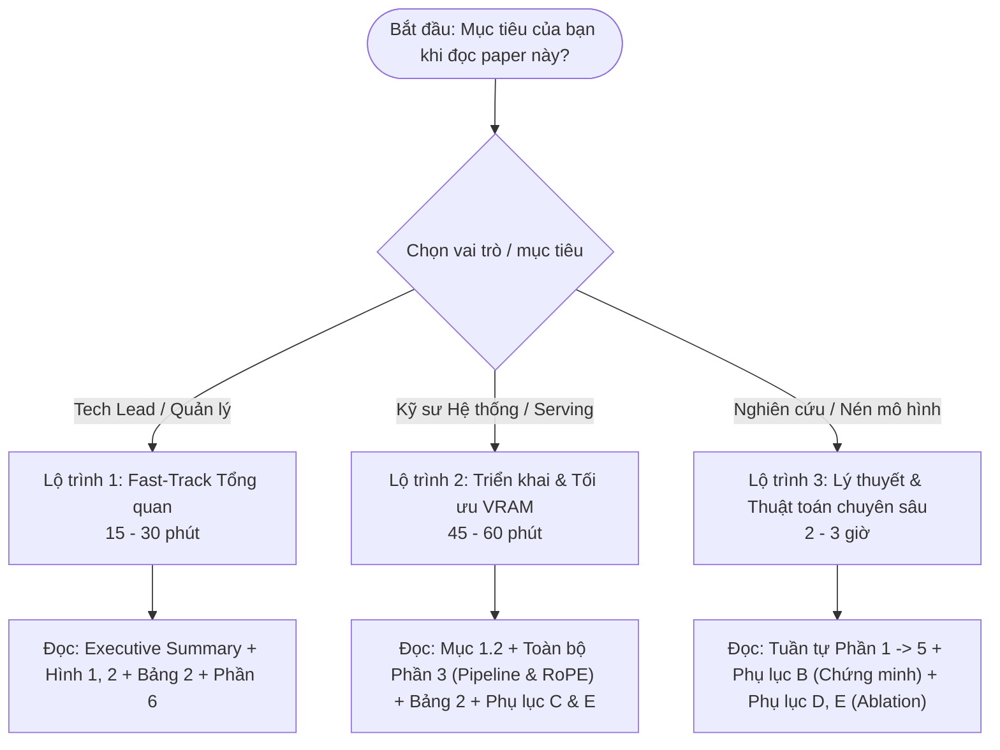
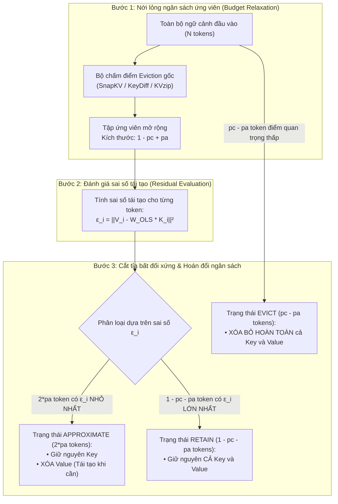

# VECTOR: Plug-in Đơn giản Nâng cao Hiệu năng Nén KV Cache Dựa trên Cơ chế Loại bỏ Token (Eviction-Based)

> **Tên bài báo gốc:** *A Simple Plug-in for Improving Eviction-Based KV Cache Compression*  
> **Tác giả:** Yuping Lin¹*, Jiayuan Ding², Yue Xing¹, Pengfei He¹, Jiliang Tang¹, Subhabrata Mukherjee²  
> **Đơn vị công tác:** ¹Michigan State University, ²Hippocratic AI  
> **Liên hệ:** {linyupin, xingyue1, hepengf1, tangjili}@msu.edu, {jiayuan, subho}@hippocraticai.com  
> **Tài liệu gốc:** [PDF đính kèm trong thư mục docs/papers](file:///D:/MyProject/ProjectIII/docs/papers/A%20simple%20plug-in%20for%20improving%20eviction-based%20kv%20cache%20compression.pdf)  
> **Mã nguồn thử nghiệm:** Xây dựng trên framework mã nguồn mở [KVPress](https://github.com/NVIDIA/kvpress)

---

## Mục lục Toàn văn

- [Lộ trình Đọc Paper (Reading Roadmap)](#lộ-trình-đọc-paper-reading-roadmap)
  - [Lộ trình 1: Fast-Track cho Quản lý & Tech Lead (15 – 30 phút)](#lộ-trình-1-fast-track-cho-quản-lý--tech-lead-15--30-phút)
  - [Lộ trình 2: Kỹ sư Triển khai & Hệ thống LLM Serving (45 – 60 phút)](#lộ-trình-2-kỹ-sư-triển-khai--hệ-thống-llm-serving-45--60-phút)
  - [Lộ trình 3: Nhà Nghiên cứu Thuật toán & Nén Mô hình (Đọc Sâu 2 – 3 giờ)](#lộ-trình-3-nhà-nghiên-cứu-thuật-toán--nén-mô-hình-đọc-sâu-2--3-giờ)
- [Tóm tắt Điều hành (Executive Summary)](#tóm-tắt-điều-hành-executive-summary)
- [Tóm tắt Bài báo (Abstract)](#tóm-tắt-bài-báo-abstract)
- [Phần 1: Giới thiệu (Introduction) & Động lực Đề xuất VECTOR](#phần-1-giới-thiệu-introduction--động-lực-đề-xuất-vector)
  - [1.1 Nút thắt của các phương pháp nén nhị phân](#11-nút-thắt-của-các-phương-pháp-nén-nhị-phân)
  - [1.2 Sự bất đối xứng độ nhạy giữa Key và Value](#12-sự-bất-đối-xứng-độ-nhạy-giữa-key-và-value)
  - [1.3 Hai câu hỏi nghiên cứu cốt lõi (RQ1 & RQ2)](#13-hai-câu-hỏi-nghiên-cứu-cốt-lõi-rq1--rq2)
  - [1.4 Các đóng góp chính của bài báo](#14-các-đóng-góp-chính-của-bài-báo)
- [Phần 2: Các Công trình Liên quan (Related Works)](#phần-2-các-công-trình-liên-quan-related-works)
  - [2.1 Ba trường phái nén KV Cache chính](#21-ba-trường-phái-nén-kv-cache-chính)
  - [2.2 Khai thác tính dư thừa không gian con K–V](#22-khai-thác-tính-dư-thừa-không-gian-con-kv)
  - [2.3 Định vị của VECTOR](#23-định-vị-của-vector)
- [Phần 3: Phương pháp luận VECTOR (Methodology)](#phần-3-phương-pháp-luận-vector-methodology)
  - [3.1 Cơ chế Xấp xỉ: Ước lượng Value qua tính cộng tuyến K–V](#31-cơ-chế-xấp-xỉ-ước-lượng-value-qua-tính-cộng-tuyến-kv)
    - [Bằng chứng thực nghiệm về tính cộng tuyến K–V (Bảng 1)](#bằng-chứng-thực-nghiệm-về-tính-cộng-tuyến-kv-bảng-1)
    - [Tại sao dùng OLS ngoại tuyến thay vì Giả nghịch đảo Moore-Penrose?](#tại-sao-dùng-ols-ngoại-tuyến-thay-vì-giả-nghịch-đảo-moore-penrose)
    - [Xử lý RoPE: Phép quay nghịch đảo (RoPE Decoupling)](#xử-lý-rope-phép-quay-nghịch-đảo-rope-decoupling)
  - [3.2 Quy trình 3 bước của VECTOR (The VECTOR Pipeline)](#32-quy-trình-3-bước-của-vector-the-vector-pipeline)
    - [Bước 1: Nới lỏng ngân sách ứng viên (Budget Relaxation)](#bước-1-nới-lỏng-ngân-sách-ứng-viên-budget-relaxation)
    - [Bước 2: Đánh giá phần dư tái tạo (Residual Evaluation)](#bước-2-đánh-giá-phần-dư-tái-tạo-residual-evaluation)
    - [Bước 3: Cắt tỉa bất đối xứng & Hoán đổi ngân sách (Asymmetric Truncation)](#bước-3-cắt-tỉa-bất-đối-xứng--hoán-đổi-ngân-sách-asymmetric-truncation)
    - [Chứng minh bảo toàn bộ nhớ VRAM](#chứng-minh-bảo-toàn-bộ-nhớ-vram)
- [Phần 4: Phân tích Lý thuyết (Theoretical Analysis)](#phần-4-phân-tích-lý-thuyết-theoretical-analysis)
  - [4.1 Mô hình hóa độ méo tín hiệu Attention](#41-mô-hình-hóa-độ-méo-tín-hiệu-attention)
  - [4.2 Mệnh đề 1: Ngưỡng $R^2_{\text{approx}}$ giảm thiểu độ méo](#42-mệnh-đề-1-ngưỡng-r2_textapprox-giảm-thiểu-độ-méo)
  - [4.3 Ví dụ 1: Phân tích dưới phân phối thặng dư Gauss](#43-ví-dụ-1-phân-tích-dưới-phân-phối-thặng-dư-gauss)
  - [4.4 Công thức xác định tỷ lệ xấp xỉ khi triển khai ($p_a^{\text{deploy}}$)](#44-công-thức-xác-định-tỷ-lệ-xấp-xỉ-khi-triển-khai-p_atextdeploy)
- [Phần 5: Thực nghiệm và Đánh giá (Experiments)](#phần-5-thực-nghiệm-và-đánh-giá-experiments)
  - [5.1 Thiết lập thực nghiệm (Experimental Setup)](#51-thiết-lập-thực-nghiệm-experimental-setup)
  - [5.2 Kết quả chính trên LongBench (Bảng 2 & Bảng 3)](#52-kết-quả-chính-trên-longbench-bảng-2--bảng-3)
  - [5.3 Phân tích độ nhạy của tỷ lệ xấp xỉ $p_a$](#53-phân-tích-độ-nhạy-của-tỷ-lệ-xấp-xỉ-p_a)
  - [5.4 Thực nghiệm Needle-in-a-Haystack (NIAH)](#54-thực-nghiệm-needle-in-a-haystack-niah)
- [Phần 6: Kết luận và Hạn chế (Conclusion & Limitations)](#phần-6-kết-luận-và-hạn-chế-conclusion--limitations)
- [Phụ lục Kỹ thuật (Appendices)](#phụ-lục-kỹ-thuật-appendices)
  - [Phụ lục A: Kết quả chi tiết trên Qwen3-0.6B (Bảng 3)](#phụ-lục-a-kết-quả-chi-tiết-trên-qwen3-06b-bảng-3)
  - [Phụ lục B: Chứng minh Toán học đầy đủ](#phụ-lục-b-chứng-minh-toán-học-đầy-đủ)
  - [Phụ lục C: Chi tiết Tái lập Thực nghiệm](#phụ-lục-c-chi-tiết-tái-lập-thực-nghiệm)
  - [Phụ lục D: Phân tích Loại trừ OLS vs Giả nghịch đảo Moore-Penrose](#phụ-lục-d-phân-tích-loại-trừ-ols-vs-giả-nghịch-đảo-moore-penrose)
  - [Phụ lục E: Phân tích Loại trừ Xấp xỉ V-only vs K-only](#phụ-lục-e-phân-tích-loại-trừ-xấp-xỉ-v-only-vs-k-only)

---

## Lộ trình Đọc Paper (Reading Roadmap)

Bài báo đề xuất giải pháp kỹ thuật có tính ứng dụng thực chiến rất cao dành cho các hệ thống phục vụ suy luận LLM (LLM Serving). Dưới đây là 3 lộ trình đọc được phân tầng theo nhu cầu thực tế:



### Lộ trình 1: Fast-Track cho Quản lý & Tech Lead (15 – 30 phút)
- **Mục tiêu:** Hiểu nhanh giá trị kinh doanh, khả năng tiết kiệm phần cứng GPU và tính khả thi khi tích hợp vào hệ thống hiện tại.
- **Các phần cần đọc:**
  1. **Executive Summary & Abstract:** Nắm bắt tại sao các phương pháp nén KV cache hiện tại (SnapKV, KeyDiff) bị giảm độ chính xác ở tỷ lệ nén cao, và VECTOR giải quyết vấn đề đó thế nào mà không tốn thêm GPU memory.
  2. **Hình 1 & Hình 2 (Trang 2 & 5):** Nắm cơ chế "Giữ - Xấp xỉ - Xóa" (Retain - Approximate - Evict) thay vì chỉ "Giữ - Xóa" nhị phân.
  3. **Bảng 2 (Trang 7):** Xem kết quả cải thiện hiệu năng thực tế trên Llama-3.1-8B và Qwen3-14B khi nén $75\% - 90\%$ KV Cache.
  4. **Phần 6 (Kết luận & Hạn chế):** Hiểu rõ chi phí tính toán phụ trội (gần như bằng 0) và phạm vi áp dụng.
- **Câu hỏi then chốt:** *"VECTOR có cần finetune lại model không? Có tốn thêm VRAM không?"* $\to$ **Không!** Hoàn toàn training-free, giữ nguyên 100% ngân sách VRAM.

### Lộ trình 2: Kỹ sư Triển khai & Hệ thống LLM Serving (45 – 60 phút)
- **Mục tiêu:** Hiểu rõ cách cài đặt thuật toán, tích hợp vào các engine suy luận (vLLM, TensorRT-LLM, HuggingFace) và xử lý kỹ thuật RoPE.
- **Các phần cần đọc:**
  1. **Mục 1.2 & 3.1:** Hiểu lý do toán học vì sao **chỉ xấp xỉ Value ($V$) mà giữ nguyên Key ($K$)** (Softmax khuếch đại sai số Key theo hàm mũ, trong khi sai số Value chỉ lan truyền tuyến tính).
  2. **Mục 3.1 (RoPE Decoupling):** Kỹ thuật nhân ma trận quay nghịch đảo $R_m^{-1} K$ để triệt tiêu thông tin vị trí của RoPE trước khi ước lượng $V$.
  3. **Mục 3.2 (Pipeline 3 bước):** Nắm cơ chế "Hoán đổi ngân sách" (Budget Swap) giúp lưu trữ thêm $p_a$ vector Key mà không phát sinh thêm bộ nhớ.
  4. **Phụ lục C (Chi tiết tái lập):** Quy trình hiệu chuẩn ngoại tuyến (Offline Calibration) 1 lần duy nhất trên tập dữ liệu C4 (chạy mất vài phút).
  5. **Phụ lục E (V-only vs K-only):** Dữ liệu chứng minh việc xấp xỉ Key làm sụp đổ mô hình như thế nào.

### Lộ trình 3: Nhà Nghiên cứu Thuật toán & Nén Mô hình (Đọc Sâu 2 – 3 giờ)
- **Mục tiêu:** Nắm vững nền tảng toán học, các chứng minh giới hạn độ méo tín hiệu Attention và các thí nghiệm ablation.
- **Các phần cần đọc:**
  1. **Tuần tự từ Phần 1 đến Phần 5:** Đọc chi tiết từng định nghĩa toán học.
  2. **Phần 4 & Phụ lục B:** Nghiên cứu kỹ **Mệnh đề 1 (Proposition 1)** và **Ví dụ 1 (Example 1)** về điều kiện hội tụ của $R^2_{\text{approx}}$ theo phân phối điểm quan trọng Pareto/Gaussian.
  3. **Phụ lục D:** Phân tích bản chất vì sao hồi quy OLS trên dữ liệu thực tế đánh bại hoàn toàn giả nghịch đảo giải tích Moore-Penrose $W_V W_K^\dagger$ (do ma trận ẩn $h$ có hiệp phương sai không đẳng hướng $\Sigma_h \ne I$).
  4. **Mục 5.3 & 5.4:** Phân tích độ nhạy của tham số $p_a$ và hiện tượng giải quyết "điểm mù" trong bài toán Needle-in-a-Haystack.

---

## Tóm tắt Điều hành (Executive Summary)

Trong suy luận ngữ cảnh dài (Long-Context Inference), bộ nhớ đệm KV Cache phình to tuyến tính theo chiều dài chuỗi, trở thành nút thắt cổ chai lớn nhất hạn chế kích thước batch và làm cạn kiệt VRAM GPU. 

Các giải pháp nén dựa trên việc loại bỏ token (Eviction-based) hiện nay như **SnapKV, KeyDiff, KVzip, PyramidKV** áp dụng chính sách **phân loại nhị phân (Binary Keep-or-Drop)**:
- Hoặc giữ lại hoàn toàn cả $(K, V)$.
- Hoặc xóa bỏ vĩnh viễn cả $(K, V)$.

Khi bị ép vào các mức nén khắt khe ($75\% - 90\%$ bộ nhớ bị cắt bỏ), chính sách nhị phân này gây ra **mất mát thông tin không thể đảo ngược (irreversible information loss)**, khiến mô hình bị suy giảm trí nhớ nghiêm trọng và suy đoán sai.

```
+----------------------------------------------------------------------------------------------------+
|                               CƠ CHẾ PHÂN BỔ TRUYỀN THỐNG (NHỊ PHÂN)                               |
|                                                                                                    |
|    Token Context ───────► [ Bộ Chấm Điểm Quan Trọng ] ──────┬───► Quan Trọng: GIỮ CẢ (K, V)        |
|                                                             └───► Ít Quan Trọng: XÓA CẢ (K, V)     |
+----------------------------------------------------------------------------------------------------+
                                                  ▼
+----------------------------------------------------------------------------------------------------+
|                               CƠ CHẾ PHÂN BỔ CỦA VECTOR (3 TRẠNG THÁI)                             |
|                                                                                                    |
|                             ┌──► Quan trọng & Khó tái tạo  ──────► RETAIN: Giữ nguyên (K, V)       |
|    Token ──► [ Importance ] │                                                                      |
|                             └──► Quan trọng & DỄ TÁI TẠO   ──────► APPROXIMATE: Giữ K, XÓA V       |
|                                                                   (Tái tạo V = W_OLS * K khi cần)  |
|                                                                                                    |
|    Token ──► [ Ít quan trọng ] ──────────────────────────────────► EVICT: Xóa bỏ cả (K, V)         |
+----------------------------------------------------------------------------------------------------+
```

### Đột phá của VECTOR:
1. **Phân bổ 3 trạng thái trực giao (Three-way Orthogonal Allocation):** Kết hợp đồng thời 2 chiều đánh giá độc lập: **Tầm quan trọng (Importance)** và **Khả năng tái tạo (Reconstructability)**.
2. **Khai thác tính cộng tuyến K–V (K–V Collinearity):** Do Key ($K = W_K h$) và Value ($V = W_V h$) cùng được chiếu tuyến tính từ một vector ẩn $h$, chúng có mối tương quan tuyến tính nội tại cực kỳ cao (hệ số xác định $R^2$ đạt từ **0.70 đến 0.94** trên khắp các họ mô hình Llama, Qwen, Gemma).
3. **Bất đối xứng độ nhạy (Asymmetric Sensitivity):** Giữ nguyên $K$ để đảm bảo độ chính xác tuyệt đối của ma trận chú ý (tránh bị Softmax khuếch đại sai số theo hàm mũ), chỉ xóa $V$ và tái tạo $V$ bằng phép nhân ma trận tĩnh cực nhanh $\hat{V} = W_{\text{OLS}} K$.
4. **Hoán đổi ngân sách (Budget Swap) bảo toàn 100% VRAM:** Với cùng một dung lượng bộ nhớ, VECTOR giữ lại được **nhiều vector Key hơn**, giúp mở rộng phạm vi chú ý của mô hình trong khi chi phí bộ nhớ không đổi.
5. **Cắm là chạy (Plug-and-play):** Không cần finetune mô hình, chỉ cần hiệu chuẩn 1 lần ngoại tuyến (Offline OLS) trên tập C4 mất vài phút, tương thích với mọi thuật toán Eviction hiện nay.

---

## Tóm tắt Bài báo (Abstract)

Sự tăng trưởng của bộ nhớ đệm KV Cache là nút thắt cổ chai lớn nhất đối với việc suy luận ngữ cảnh dài trong các mô hình ngôn ngữ lớn (LLMs). Các phương pháp nén dựa trên việc loại bỏ token (Eviction-based) hiện nay thường sử dụng chính sách giữ-hoặc-xóa nhị phân (binary keep-or-drop). Cơ chế này dẫn đến sự mất mát thông tin không thể đảo ngược ở các mức nén cao, làm suy giảm hiệu năng tác vụ hạ nguồn. 

Để giải quyết vấn đề này, chúng tôi đề xuất **VECTOR** (**V**alue **E**stimation via **C**ollinearity and **T**hree-way **O**rthogonal **R**outing) — một giải pháp cắm-là-chạy (plug-and-play) giúp nâng cấp các phương pháp nén eviction hiện có thông qua việc bổ sung trạng thái **xấp xỉ (approximation)** bên cạnh việc giữ lại (retention) và loại bỏ (eviction). 

VECTOR tận dụng tính chất bất đối xứng về độ nhạy của attention: 
- Bảo toàn nguyên vẹn các vector Key để duy trì tính toàn vẹn của ma trận phân bổ attention.
- Loại bỏ các vector Value dễ đoán và tái tạo lại chúng khi cần bằng mô hình hồi quy bình phương tối thiểu thông thường (OLS) được hiệu chuẩn ngoại tuyến, dựa trên tính cộng tuyến nội tại giữa Key và Value.

Bằng cách định tuyến token theo hai trục trực giao: **tầm quan trọng (importance)** và **khả năng tái tạo (reconstructability)**, VECTOR thu hồi lại phần thông tin bị mất mát mà phương pháp nén nhị phân bỏ qua dưới cùng một ngân sách bộ nhớ. 

Chúng tôi cung cấp phân tích lý thuyết chứng minh rằng việc mở rộng trạng thái xấp xỉ sẽ làm giảm độ méo thông tin toàn cục khi khả năng dự đoán $R^2$ vượt qua một ngưỡng phụ thuộc vào độ lệch của phân phối điểm quan trọng. Thực nghiệm trên các benchmark ngữ cảnh dài cho thấy việc tích hợp VECTOR vào các phương pháp eviction baseline giúp cải thiện rõ rệt hiệu năng suy luận ở các chế độ nén cao (lên tới $90\%$).

---

## Phần 1: Giới thiệu (Introduction) & Động lực Đề xuất VECTOR

### 1.1 Nút thắt của các phương pháp nén nhị phân
Trong các mô hình Transformer sinh tự hồi quy, việc duy trì toàn bộ KV Cache cho ngữ cảnh dài (hàng chục nghìn đến hàng trăm nghìn token) đòi hỏi dung lượng VRAM khổng lồ. 

Các phương pháp nén KV Cache dựa trên cơ chế loại bỏ token (Eviction-based: như SnapKV, KeyDiff, KVzip, PyramidKV) giải quyết vấn đề này bằng cách chấm điểm tầm quan trọng của từng token và loại bỏ vĩnh viễn các token có điểm thấp. Tuy nhiên, bản chất của chúng là **chính sách nhị phân (binary decision)**:
- Token được chọn sẽ giữ lại toàn bộ cặp $(K, V)$.
- Token bị loại sẽ bị xóa sạch hoàn toàn cả $K$ và $V$.

Khi hệ thống bắt buộc phải nén mạnh (ví dụ cắt giảm $75\%$ đến $90\%$ dung lượng cache), số lượng token bị xóa là rất lớn. Rất nhiều token mang thông tin ngữ cảnh hữu ích bị vứt bỏ vĩnh viễn, dẫn đến việc suy giảm độ chính xác nghiêm trọng.

### 1.2 Sự bất đối xứng độ nhạy giữa Key và Value
Các nghiên cứu gần đây về cơ chế Attention [18, 19, 24] chỉ ra một đặc tính toán học cốt lõi: **Độ nhạy cảm với sai số giữa Key và Value là hoàn toàn bất đối xứng**.

Xét công thức Attention:
$$\text{Attention}(Q, K, V) = \text{softmax}\left(\frac{Q K^\top}{\sqrt{d}}\right) V$$

1. **Vector Key ($K$):** Đóng vai trò quyết định trọng số phân bổ của hàm Softmax. Do Softmax chứa hàm mũ $e^x$, **bất kỳ sai số hay nhiễu nhỏ nào trên Key đều bị khuếch đại theo hàm mũ (exponentially amplified)**, làm sai lệch hoàn toàn bản đồ chú ý (attention map) và khiến mô hình "nhìn nhầm chỗ".
2. **Vector Value ($V$):** Được nhân với trọng số chú ý sau khi hàm Softmax đã chuẩn hóa. Do đó, **sai số trên Value chỉ lan truyền tuyến tính (propagates linearly)** qua phép tính tổng có trọng số.

> **Hệ quả kiến trúc:** Việc xấp xỉ Key tiềm ẩn rủi ro cực lớn làm sụp đổ mô hình, trong khi xấp xỉ Value an toàn hơn rất nhiều! Do đó, chiến lược tối ưu là: **Giữ nguyên Key chính xác, chỉ xấp xỉ Value**.

### 1.3 Hai câu hỏi nghiên cứu cốt lõi (RQ1 & RQ2)
Từ các quan sát trên, nhóm tác giả đặt ra hai câu hỏi nghiên cứu:
- **RQ1 (Cơ chế tái tạo):** *Liệu chúng ta có thể xây dựng một cơ chế tái tạo siêu nhẹ, khôi phục được biểu diễn Value với chi phí runtime thấp mà không cần huấn luyện lại kiến trúc mô hình hay không?*
- **RQ2 (Chiến lược phân bổ):** *Dưới một ngân sách bộ nhớ KV cố định, làm thế nào để kết hợp đồng thời độ quan trọng và khả năng tái tạo để phân bổ token vào 3 trạng thái: Giữ lại (Retain), Xấp xỉ (Approximate), và Loại bỏ (Evict)?*

### 1.4 Các đóng góp chính của bài báo
1. **Góc nhìn phân bổ 3 trạng thái nhận biết khả năng tái tạo:** Chuyển đổi bài toán nén KV Cache từ quyết định giữ/xóa nhị phân sang bài toán tối ưu phân bổ 3 trạng thái (Retain - Approximate - Evict) dựa trên 2 trục trực giao.
2. **Mô-đun tái tạo $K \to V$ siêu nhẹ:** Sử dụng hồi quy tuyến tính OLS được hiệu chuẩn ngoại tuyến một lần duy nhất, kết hợp cơ chế khử RoPE nghịch đảo nhanh, cho phép tái tạo Value tức thì trong lúc giải mã.
3. **Nâng cấp cắm-là-chạy (Plug-and-Play):** VECTOR có thể gắn vào bất kỳ thuật toán eviction nào (dựa trên attention-score hay key-geometry) mà không cần can thiệp kiến trúc mô hình.
4. **Hiệu quả thực nghiệm vượt trội dưới ngân sách khắt khe:** Cải thiện rõ rệt điểm số trên benchmark LongBench và Needle-in-a-Haystack ở các mức nén $50\% - 90\%$.

---

## Phần 2: Các Công trình Liên quan (Related Works)

### 2.1 Ba trường phái nén KV Cache chính
Hiện nay có 3 hướng tiếp cận chính để nén KV Cache:
1. **Lược bỏ Token (Eviction-based):** Đánh giá tầm quan trọng của token và loại bỏ các mục điểm thấp (SnapKV, H2O, StreamingLLM, KeyDiff, PyramidKV). Hiệu quả cao nhưng là chính sách nhị phân gây mất mát thông tin vĩnh viễn dưới ngân sách eo hẹp.
2. **Lượng tử hóa (Quantization):** Giảm số bit biểu diễn cho mỗi trọng số KV (KIVI, SmoothQuant, KVQuant). Ít phá hủy ngữ cảnh hơn nhưng bị giới hạn tỷ lệ nén (thường tối đa 2x – 4x) và đòi hỏi phần cứng hỗ trợ kiểu số đặc thù.
3. **Xấp xỉ (Approximation):** Tái tạo lại biểu diễn KV qua phép chiếu hạng thấp hoặc mô hình hóa phần dư (residual modeling). Các phương pháp đa trạng thái gần đây như ARKV [12] và D2O [13] chứng minh phân bổ phi nhị phân vượt trội hơn phân bổ nhị phân, nhưng chúng phụ thuộc hoàn toàn vào tín hiệu attention score đơn lẻ.

### 2.2 Khai thác tính dư thừa không gian con K–V
Vì Key và Value đều được chiếu tuyến tính từ cùng một vector ẩn $h$ của Transformer ($K = W_K h, V = W_V h$), chúng chia sẻ cấu trúc không gian con chung:
- Kiến trúc **MLA (Multi-head Latent Attention)** trong DeepSeek-V2/V3 nén KV vào một không gian ẩn tiềm năng chung [23].
- Các công trình như **AQUA-KV** [14] và **EliteKV** [15] khai thác sự phụ thuộc K–V qua lượng tử hóa phần dư hoặc phép chiếu hạng thấp đồng thời.

### 2.3 Định vị của VECTOR
VECTOR không phải là một phương pháp nén độc lập mà là một **mô-đun cắm thêm (Plug-in augmentation)** dành riêng cho các thuật toán Eviction:
- Không cần sửa đổi kiến trúc, không cần huấn luyện lại.
- Mở rộng không gian quyết định từ 2 trạng thái lên 3 trạng thái bằng cách đưa vào chiều đánh giá thứ hai: **Khả năng tái tạo (Reconstructability)** — một yếu tố mà các phương pháp đa trạng thái trước đây chưa từng mô hình hóa.

---

## Phần 3: Phương pháp luận VECTOR (Methodology)

### 3.1 Cơ chế Xấp xỉ: Ước lượng Value qua tính cộng tuyến K–V

#### Bằng chứng thực nghiệm về tính cộng tuyến K–V (Bảng 1)
Trước khi thiết kế thuật toán, nhóm tác giả kiểm chứng tiền đề: *Liệu một phép ánh xạ tuyến tính đơn giản có thể dự đoán chính xác $V$ từ $K$ trên nhiều họ mô hình, quy mô và kiến trúc khác nhau hay không?*

Họ sử dụng tập dữ liệu tiền huấn luyện C4 [25], thu thập các cặp kích hoạt $(K, V)$ tại từng tầng Transformer từ 10,000 chuỗi văn bản (độ dài 4,096 token), sau đó khớp ma trận hồi quy OLS ngoại tuyến.

**Bảng 1: Khả năng dự đoán $K \to V$ bằng OLS ngoại tuyến (Đo bằng hệ số xác định $R^2_{\text{global}}$ trung bình trên tất cả các tầng)**

| Họ mô hình | Quy mô tham số | Kiểu kiến trúc | $R^2_{\text{global}}$ (Trung bình các tầng) |
| :--- | :---: | :---: | :---: |
| **Llama-3.1-8B** | 8B | Dense Transformer | **0.6964** |
| **Qwen3-14B** | 14B | Dense Transformer | **0.6946** |
| **Qwen3-0.6B** | 0.6B | Dense Transformer | **0.9392** |
| **Gemma-3-4B** | 4B | Dense Transformer | **0.8896** |
| **Qwen3-30B-A3B** | 30B (MoE 3B active) | Mixture-of-Experts | **0.6863** |

> **Nhận xét quan trọng:** Giá trị $R^2$ đạt từ xấp xỉ **0.70 đến 0.94** trên mọi mô hình. Điều này chứng minh rằng vector Value có thể được tái tạo lại từ vector Key với độ chính xác tuyến tính cực kỳ cao!

---

#### Tại sao dùng OLS ngoại tuyến thay vì Giả nghịch đảo Moore-Penrose?
Về mặt lý thuyết thuần túy, ta có $K = W_K h$ và $V = W_V h$. Người ta có thể nghĩ đến việc tính ma trận giải tích thông qua giả nghịch đảo Moore-Penrose:
$$\hat{W} = W_V W_K^\dagger$$
Tuy nhiên, trong thực tế, **cách tiếp cận giải tích Moore-Penrose hoàn toàn thất bại** (xem Phụ lục D, $R^2 < 0$ trên hầu hết các tầng). Lý do là vì:
- Giả nghịch đảo $W_K^\dagger$ ngầm giả định rằng không gian ẩn $h$ là đẳng hướng (nhiễu trắng, hiệp phương sai $\Sigma_h = I$).
- Trong thực tế, các biểu diễn ẩn $h$ của LLM phân bố trên một đa tạp phi đẳng hướng cao (anisotropic manifold), tập trung năng lượng vào một số chiều chủ đạo.
- Ngược lại, **OLS ngoại tuyến** giải trực tiếp bài toán tối ưu:
  $$W_{\text{OLS}} = \arg\min_W \mathbb{E}_{h \sim \mathcal{D}}\left[\|W_V h - W W_K h\|_2^2\right] = \Sigma_{VK} \Sigma_{KK}^{-1}$$
  Do đó, OLS nắm bắt chính xác phân phối kích hoạt thực tế và mang lại chất lượng tái tạo vượt trội.

---

#### Xử lý RoPE: Phép quay nghịch đảo (RoPE Decoupling)
Trong hầu hết các LLM hiện đại, cơ chế mã hóa vị trí quay (RoPE) [30] được áp dụng lên Key tại vị trí token $m$:
$$K_{\text{post-RoPE}} = R_m W_K h$$
Trong khi đó, Value lại không bị xoay bởi RoPE:
$$V = W_V h$$

Nếu khớp ma trận $W_{\text{OLS}}$ trực tiếp trên $K_{\text{post-RoPE}}$, ma trận dự đoán sẽ bị phụ thuộc vào từng vị trí $m$, làm bùng nổ độ phức tạp tính toán. 

**Giải pháp của VECTOR:** Trong quá trình nén và tái tạo, VECTOR áp dụng phép quay nghịch đảo cực nhanh lên vector Key đã lưu:
$$K_{\text{decoupled}} = R_m^{-1} K_{\text{post-RoPE}} = W_K h$$
Sau đó nhân với ma trận OLS tĩnh:
$$\hat{V} = W_{\text{OLS}} K_{\text{decoupled}}$$
Phép quay nghịch đảo RoPE chỉ là việc đổi dấu góc quay $\theta_m$, chi phí tính toán $\mathcal{O}(d)$ là không đáng kể nhưng giúp ma trận $W_{\text{OLS}}$ hoạt động chính xác ở mọi vị trí token trong văn bản dài.

---

### 3.2 Quy trình 3 bước của VECTOR (The VECTOR Pipeline)

Ký hiệu $p_c \in (0, 1)$ là tỷ lệ nén bộ nhớ mục tiêu (ví dụ $p_c = 0.75$ tức là muốn giảm $75\%$ dung lượng KV Cache, chỉ giữ lại $25\%$). Ký hiệu $p_a$ là tỷ lệ xấp xỉ (approximation ratio).

Quy trình nén của VECTOR diễn ra theo 3 bước:



#### Bước 1: Nới lỏng ngân sách ứng viên (Budget Relaxation)
Thay vì chỉ chọn ra tập ứng viên có kích thước bằng đúng ngân sách $1 - p_c$, VECTOR gọi thuật toán eviction gốc để chọn ra một **tập ứng viên mở rộng** có kích thước:
$$N_{\text{cand}} = 1 - p_c + p_a$$
Điều này giúp giữ lại một tập hợp token rộng hơn, hạn chế việc vô tình loại bỏ các token có ích.

#### Bước 2: Đánh giá phần dư tái tạo (Residual Evaluation)
Với mỗi token $i$ nằm trong tập ứng viên mở rộng, VECTOR tính sai số tái tạo L2:
$$\varepsilon_i = \|V_i - W_{\text{OLS}} K_i\|_2^2$$
Bước này bổ sung một chiều đánh giá độc lập hoàn toàn với điểm attention: **Khả năng tái tạo (Reconstructability)** — đo lường lượng thông tin bị mất nếu ta quyết định vứt bỏ vector Value của token này.

#### Bước 3: Cắt tỉa bất đối xứng & Hoán đổi ngân sách (Asymmetric Truncation)
VECTOR chia tập ứng viên thành các nhóm:
1. **Giữ lại Key của toàn bộ $1 - p_c + p_a$ token ứng viên.**
2. Chọn ra **$2p_a$ token có sai số $\varepsilon_i$ nhỏ nhất** (tức là những token dễ đoán nhất): **Xóa vector Value của chúng**, đưa vào trạng thái **Approximate**. Trong quá trình giải mã, khi cần tính attention, $\hat{V}$ sẽ được tái tạo động qua $\hat{V} = W_{\text{OLS}} K$.
3. Với **$1 - p_c - p_a$ token còn lại** trong tập ứng viên (những token khó đoán nhất): **Giữ nguyên cả Key và Value**, đưa vào trạng thái **Retain**.
4. Toàn bộ các token còn lại ngoài tập ứng viên ($p_c - p_a$ token): Bị xóa bỏ hoàn toàn, đưa vào trạng thái **Evict**.

---

#### Chứng minh bảo toàn bộ nhớ VRAM
Hãy tính toán tổng số lượng vector Key và Value được lưu trữ trong VRAM:
- Số lượng Key được lưu: $1 - p_c + p_a$
- Số lượng Value được lưu: $1 - p_c - p_a$
- Tổng dung lượng bộ nhớ tiêu thụ:
  $$\text{Memory} = (1 - p_c + p_a) + (1 - p_c - p_a) = 2(1 - p_c)$$
  Con số này **chính xác bằng dung lượng của $1 - p_c$ cặp $(K, V)$ đầy đủ**!

> **Ý nghĩa mấu chốt:** Bằng việc "hy sinh" $2p_a$ vector Value dễ đoán, VECTOR đổi lấy được thêm $p_a$ vector Key chính xác. Điều này giúp mở rộng tầm nhìn của ma trận Attention mà **không tốn thêm một byte VRAM nào**!

---

## Phần 4: Phân tích Lý thuyết (Theoretical Analysis)

### 4.1 Mô hình hóa độ méo tín hiệu Attention
Để trả lời câu hỏi: *Khi nào thì việc mở rộng trạng thái Xấp xỉ thực sự làm giảm mất mát thông tin so với việc nén nhị phân?*, nhóm tác giả định nghĩa hàm đo lường độ méo tín hiệu có trọng số $E$:
- Token bị Evict đóng góp độ méo toàn phần là $1$.
- Token được Retain đóng góp độ méo là $0$.
- Token được Approximate đóng góp độ méo tương đối: $\frac{\|V_i - \hat{V}_i\|_2^2}{\|V_i\|_2^2} \in [0, 1]$.

Ký hiệu $I_E$ và $I_A$ lần lượt là tập chỉ số của các token bị Evict và Approximate; $w_i$ là điểm quan trọng của token $i$:
$$E(p_a, p_c) = \sum_{i \in I_E} w_i + \sum_{i \in I_A} w_i \frac{\|V_i - \hat{V}_i\|_2^2}{\|V_i\|_2^2} \approx \sum_{i \in I_E} w_i + \left(\sum_{i \in I_A} w_i\right) \cdot \mu_A$$
Trong đó $\mu_A = 1 - R^2_{\text{approx}}(p_a, p_c)$ là sai số tái tạo tương đối trung bình trên tập Approximate, và $R^2_{\text{approx}}$ là hệ số $R^2$ tính riêng trên tập token được xấp xỉ.

---

### 4.2 Mệnh đề 1: Ngưỡng $R^2_{\text{approx}}$ giảm thiểu độ méo

**Mệnh đề 1 (Proposition 1):**  
*Gọi $\bar{w} = \frac{1 - \sum_{i \in I_E} w_i}{1 - p_c + p_a}$ là điểm quan trọng trung bình của các token trong tập ứng viên mở rộng, và $w^*$ là điểm quan trọng của token nằm tại ranh giới cắt tỉa của tập Eviction. Việc mở rộng trạng thái Xấp xỉ ($p_a > 0$) sẽ làm giảm độ méo toàn cục $E$ khi và chỉ khi:*
$$R^2_{\text{approx}} > \frac{\bar{w}}{w^* + \bar{w}}$$

#### Ý nghĩa trực giác của Mệnh đề 1:
Khi ta tăng tỷ lệ xấp xỉ $p_a$, trạng thái Approximate nhận token từ hai nguồn:
1. Nhận thêm token từ tập Evict (mang lại lợi ích phục hồi thông tin).
2. Lấy bớt token từ tập Retain (gây thêm sai số xấp xỉ).

Nếu phân phối điểm quan trọng bị lệch mạnh ($\bar{w} \gg w^*$), hiệu ứng thứ hai sẽ chiếm ưu thế. Khi đó, bộ ước lượng OLS bắt buộc phải đạt độ chính xác $R^2_{\text{approx}}$ đủ cao để bù đắp sai số và mang lại lợi ích ròng.

---

### 4.3 Ví dụ 1: Phân tích dưới phân phối thặng dư Gauss

**Ví dụ 1 (Example 1):**  
Giả định phần dư OLS $r_i$ tuân theo phân phối chuẩn độc lập $r_i \sim \mathcal{N}(0, \sigma^2)$ và phương sai của $\|V_i\|_2$ là $\Sigma^2$ ($\Sigma^2 > \sigma^2$). Đặt $\eta(p_a, p_c) := \sigma \Phi^{-1}\left(\frac{1}{2} + \frac{p_a}{1 - p_c + p_a}\right)$ (với $\Phi$ là hàm phân phối tích lũy chuẩn tắc). Khi đó:
$$E(p_a, p_c) \approx \sum_{i \in I_E} w_i + 2p_a \bar{w} \frac{\sigma^2}{\Sigma^2} \left[1 - \frac{2(\eta/\sigma) \phi(\eta/\sigma)}{\frac{2p_a}{1 - p_c + p_a}}\right]$$

Kết hợp Mệnh đề 1 và Ví dụ 1: Phương pháp đạt hiệu quả cao nhất khi phân phối điểm quan trọng tập trung vào tập ứng viên và vector Value có tính dự đoán cao từ Key ($\sigma^2 \ll \Sigma^2$).

---

### 4.4 Công thức xác định tỷ lệ xấp xỉ khi triển khai ($p_a^{\text{deploy}}$)
Trong thực tế suy luận, do độ dài ngữ cảnh và phân phối điểm quan trọng thay đổi liên tục theo từng mẫu văn bản, ta không thể tối ưu hóa $w^*$ và $\bar{w}$ một cách động tại từng bước giải mã. Nhóm tác giả đề xuất công thức kinh nghiệm siêu đơn giản:

$$p_a^{\text{deploy}} = \min\left(\frac{p_c}{2}, \frac{1 - p_c - \epsilon}{2}\right) \tag{1}$$

Trong đó $\epsilon > 0$ là một hằng số nhỏ để đảm bảo tập Retain không bị rỗng.
- Thành phần thứ nhất ($\frac{p_c}{2}$): Đảm bảo số lượng token xấp xỉ không vượt quá một nửa ngân sách nén.
- Thành phần thứ hai ($\frac{1 - p_c - \epsilon}{2}$): Đảm bảo luôn dành đủ không gian bộ nhớ cho các token tối quan trọng trong tập Retain.

Ví dụ với các mức nén điển hình:
- Khi $p_c = 0.25 \to p_a = 0.125$
- Khi $p_c = 0.50 \to p_a = 0.25$
- Khi $p_c = 0.75 \to p_a = 0.125$
- Khi $p_c = 0.90 \to p_a = 0.05$

---

## Phần 5: Thực nghiệm và Đánh giá (Experiments)

### 5.1 Thiết lập thực nghiệm (Experimental Setup)
- **Framework đánh giá:** Sử dụng [KVPress](https://github.com/NVIDIA/kvpress) dưới giao thức thống nhất cho nén ngữ cảnh dài.
- **Mô hình thử nghiệm:** `Llama-3.1-8B-Instruct`, `Qwen3-14B`, và `Qwen3-0.6B`.
- **Dữ liệu hiệu chuẩn OLS:** Thu thập 10,000 chuỗi (độ dài 4,096) từ tập dữ liệu C4 để khớp ma trận $W_{\text{OLS}}$ cho từng tầng Transformer. Ma trận này được cố định cho tất cả các thực nghiệm sau đó.
- **Baseline so sánh:** 4 thuật toán eviction tiêu biểu:
  - *Query-aware (Nhận biết câu hỏi):* **SnapKV** [9] và **PyramidKV** [20].
  - *Query-agnostic (Không phụ thuộc câu hỏi):* **KeyDiff** [10] (dựa trên độ đa dạng hình học của Key) và **KVzip** [11] (dựa trên độ dư thừa ngữ nghĩa).
- **Bộ benchmark:** 
  - **LongBench** [33]: Đánh giá trên 16 tác vụ tiếng Anh và lập trình (bao gồm hỏi đáp đơn văn bản, đa văn bản, tóm tắt tài liệu, và phân tích mã nguồn).
  - **Needle-in-a-Haystack (NIAH)** [34]: Đánh giá khả năng truy xuất thông tin quan trọng bị giấu ở các độ sâu ngữ cảnh khác nhau lên tới 32K tokens.

---

### 5.2 Kết quả chính trên LongBench (Bảng 2 & Bảng 3)

Dưới đây là điểm số trung bình (Avg) trên 16 tác vụ LongBench ở các mức nén $p_c \in \{0.25, 0.50, 0.75, 0.90\}$:

#### Bảng 2 (Trích đoạn): Điểm LongBench trung bình trên Llama-3.1-8B và Qwen3-14B

| Mô hình | Phương pháp Baseline | Tỷ lệ nén $p_c$ | Điểm Gốc (Baseline) | Điểm khi Tích Hợp (+ VECTOR) | Mức Cải Thiện ($\Delta$) |
| :--- | :--- | :---: | :---: | :---: | :---: |
| **Llama-3.1-8B** | **Full KV (No Comp.)** | 0.00 | 48.74 | – | – |
| | **KeyDiff** | 0.25 | 44.59 | **46.85** | <span style="color:green">**+2.26**</span> |
| | | 0.50 | 40.85 | **44.92** | <span style="color:green">**+4.07**</span> |
| | | 0.75 | 32.74 | **38.86** | <span style="color:green">**+6.12**</span> |
| | | 0.90 | 25.13 | **30.12** | <span style="color:green">**+4.99**</span> |
| | **SnapKV** | 0.25 | 45.41 | **45.46** | +0.05 |
| | | 0.50 | 44.47 | **45.08** | <span style="color:green">**+0.61**</span> |
| | | 0.75 | 43.38 | **45.11** | <span style="color:green">**+1.73**</span> |
| | | 0.90 | 42.16 | **45.20** | <span style="color:green">**+3.04**</span> |
| | **KVzip** | 0.25 | 45.23 | **45.49** | +0.26 |
| | | 0.50 | 43.82 | **45.08** | <span style="color:green">**+1.26**</span> |
| | | 0.75 | 44.95 | **45.11** | +0.16 |
| | | 0.90 | 41.23 | **45.20** | <span style="color:green">**+3.97**</span> |
| | **PyramidKV** | 0.25 | 47.56 | **47.63** | +0.07 |
| | | 0.50 | 46.97 | **47.31** | +0.34 |
| | | 0.75 | 46.00 | **46.54** | <span style="color:green">**+0.54**</span> |
| | | 0.90 | 43.52 | **45.06** | <span style="color:green">**+1.54**</span> |
| **Qwen3-14B** | **Full KV (No Comp.)** | 0.00 | 50.08 | – | – |
| | **KeyDiff** | 0.25 | 46.61 | **49.48** | <span style="color:green">**+2.87**</span> |
| | | 0.50 | 40.72 | **47.75** | <span style="color:green">**+7.03**</span> |
| | | 0.75 | 32.23 | **41.38** | <span style="color:green">**+9.15**</span> |
| | | 0.90 | 22.71 | **32.44** | <span style="color:green">**+9.73**</span> |
| | **SnapKV** | 0.25 | 50.06 | 49.79 | -0.27 |
| | | 0.50 | 49.81 | 49.01 | -0.80 |
| | | 0.75 | 49.13 | 48.63 | -0.50 |
| | | 0.90 | 46.29 | **47.65** | <span style="color:green">**+1.36**</span> |
| | **KVzip** | 0.25 | 49.90 | 49.58 | -0.32 |
| | | 0.50 | 49.98 | 48.82 | -1.16 |
| | | 0.75 | 49.49 | 49.14 | -0.35 |
| | | 0.90 | 44.75 | **47.53** | <span style="color:green">**+2.78**</span> |
| | **PyramidKV** | 0.25 | 50.83 | 50.69 | -0.14 |
| | | 0.50 | 49.82 | 49.29 | -0.53 |
| | | 0.75 | 48.60 | **48.70** | +0.10 |
| | | 0.90 | 45.89 | 45.56 | -0.33 |

#### Phân tích kết quả:
1. **Cực kỳ hiệu quả ở mức nén cao ($p_c = 0.75 - 0.90$):**  
   Khi ngân sách VRAM bị cắt giảm tới $90\%$, việc tích hợp VECTOR mang lại sự tăng vọt về hiệu năng. Trên Llama-3.1-8B ở $p_c = 0.90$, SnapKV + VECTOR tăng từ 42.16 lên 45.20 (+3.04 điểm), KVzip + VECTOR tăng từ 41.23 lên 45.20 (+3.97 điểm).
2. **Cứu cánh cho các phương pháp Query-Agnostic (KeyDiff):**  
   KeyDiff vốn chỉ dựa vào hình học của Key mà không biết câu hỏi người dùng, nên khi nén $90\%$ trên Qwen3-14B, điểm số bị rơi tự do xuống 22.71%. Khi gắn thêm VECTOR, điểm số tăng vọt lên **32.44% (+9.73 điểm)**, phục hồi gần một nửa lượng suy hao.
3. **Mô hình nhỏ hưởng lợi nhiều nhất:**  
   Trên mô hình nhỏ Qwen3-0.6B (Bảng 3, Phụ lục A), do $R^2$ cộng tuyến K–V lên tới 0.9392, VECTOR giúp phục hồi hiệu năng vượt trội ở mọi mức nén.

---

### 5.3 Phân tích độ nhạy của tỷ lệ xấp xỉ $p_a$

Hình 3 trong bài báo khảo sát sự biến thiên của điểm số LongBench khi quét $p_a$ từ $0.0$ đến $0.40$ trên mô hình Llama-3.1-8B kết hợp với SnapKV:

```
        Điểm LongBench (%)
          ▲
     46.0 │                          [Đỉnh tối ưu: pa = 0.20, Acc = 44.3%]
          │                                  ╭───╮
     44.0 │                         ╭────────╯   ╰────────╮
          │               ╭─────────╯                     ╰───╮ (Sụp đổ khi pa quá lớn)
     42.0 │      ─────────╯ (pc = 0.75)                       ╰────────
          │
     40.0 │─────────────────────────────────────────────────────────────►
          0.00       0.05       0.10       0.15       0.20       0.25       pa
```

- **Khi $p_a$ quá nhỏ ($p_a \to 0$):** Quá ít token được đưa vào tầng Xấp xỉ, cơ chế thoái hóa về dạng nhị phân thông thường, không tận dụng được thông tin có thể phục hồi.
- **Khi $p_a$ vừa phải:** Điểm số tăng dần và đạt đỉnh tại $p_a = 0.20$ đối với $p_c = 0.75$ (tăng từ 42.9% lên 44.3%).
- **Khi $p_a$ quá lớn ($p_a > 0.25$):** Điểm số sụp đổ mạnh (rơi xuống 41.6%). Nguyên nhân là do:
  1. Tập Retain bị thu hẹp quá mức, ép cả những token khó tái tạo vào trạng thái xấp xỉ.
  2. Các token dễ tái tạo nhưng ít quan trọng lại bị xấp xỉ thay vì bị xóa, gây lãng phí ngân sách.

> Điều này hoàn toàn khớp với dự đoán lý thuyết của Mệnh đề 1 và củng cố tính đúng đắn của công thức kinh nghiệm $p_a^{\text{deploy}}$ (Phương trình 1).

---

### 5.4 Thực nghiệm Needle-in-a-Haystack (NIAH)

Trong thực nghiệm "Tìm kim trong đáy bể" (Hình 4 trong bài báo), mô hình được yêu cầu tìm một câu thông tin ngẫu nhiên được giấu ở các độ sâu khác nhau (từ 0% đến 100%) trong một tài liệu dài tới 32K token, dưới mức nén $p_c = 0.75$:
- **KeyDiff gốc:** Bị xuất hiện các mảng màu đỏ lớn ("điểm mù" truy xuất thất bại hoàn toàn) ở các vị trí độ sâu từ 33% đến 67% khi chiều dài vượt quá 15K token.
- **KeyDiff + VECTOR:** Toàn bộ vùng điểm mù chuyển thành màu xanh lá cây đậm (độ chính xác 100%).
- **SnapKV + VECTOR:** Giữ vững độ chính xác hoàn hảo 100% trên toàn bộ ma trận độ dài và độ sâu.

---

## Phần 6: Kết luận và Hạn chế (Conclusion & Limitations)

### Kết luận
VECTOR đã chứng minh rằng: **Nén KV Cache không nhất thiết phải là một quyết định giữ-hoặc-xóa nhị phân cứng nhắc**. Bằng cách khai thác tính cộng tuyến tuyến tính K–V và sự bất đối xứng độ nhạy của attention, VECTOR thiết lập một cơ chế định tuyến 3 trạng thái (Retain - Approximate - Evict) hiệu quả, nhẹ nhàng và bảo toàn 100% ngân sách bộ nhớ. Là một mô-đun độc lập và cắm-là-chạy, VECTOR mở ra hướng đi đầy triển vọng cho việc tối ưu hóa các hệ thống phục vụ LLM ngữ cảnh dài trong tương lai.

### Các Hạn chế Hiện tại
1. **Tham số $p_a$ theo công thức tĩnh:** Hiện tại $p_a$ được tính theo công thức kinh nghiệm cố định mà chưa được tối ưu hóa động theo từng mẫu (per-sample) hay từng tầng (per-layer).
2. **Mức cải thiện khiêm tốn trên các baseline Query-Aware:** Trên các phương pháp đã biết trước câu hỏi như SnapKV và PyramidKV, các token liên quan mật thiết đến câu hỏi đã được bảo tồn khá tốt, do đó biên độ cải thiện của VECTOR không quá đột biến như trên các phương pháp Query-Agnostic.

---

## Phụ lục Kỹ thuật (Appendices)

### Phụ lục A: Kết quả chi tiết trên Qwen3-0.6B (Bảng 3)

Mô hình nhỏ Qwen3-0.6B có mức độ cộng tuyến K–V cực cao ($R^2 = 0.9392$). Dưới đây là kết quả trên các mức nén khắt khe:

| Thuật toán | Tỷ lệ nén $p_c$ | Điểm Gốc | Điểm + VECTOR | Chênh lệch ($\Delta$) |
| :--- | :---: | :---: | :---: | :---: |
| **No Comp. (Full KV)** | 0.00 | **30.93** | – | – |
| **KeyDiff** | 0.50 | 23.13 | **26.96** | <span style="color:green">**+3.83**</span> |
| | 0.75 | 16.72 | **22.56** | <span style="color:green">**+5.84**</span> |
| | 0.90 | 13.91 | **19.16** | <span style="color:green">**+5.25**</span> |
| **SnapKV** | 0.50 | 29.89 | **30.46** | +0.57 |
| | 0.75 | 27.24 | **28.98** | <span style="color:green">**+1.74**</span> |
| | 0.90 | 23.86 | **26.81** | <span style="color:green">**+2.95**</span> |
| **KVzip** | 0.50 | 29.87 | **30.44** | +0.57 |
| | 0.75 | 27.53 | **29.17** | <span style="color:green">**+1.64**</span> |
| | 0.90 | 24.36 | **27.10** | <span style="color:green">**+2.74**</span> |

---

### Phụ lục B: Chứng minh Toán học đầy đủ

#### Chứng minh Mệnh đề 1 (Proof of Proposition 1)
Xem xét sự thay đổi của độ méo $E$ khi tăng một lượng vô cùng bé $\delta > 0$ vào tỷ lệ xấp xỉ $p_a$:
$$\Delta E = E(p_a + \delta, p_c) - E(p_a, p_c)$$
Khi tăng $p_a$, các token ở biên tập Eviction (có điểm quan trọng $w^*$) được chuyển sang tập Approximate, giúp giảm độ méo một lượng tỉ lệ với $w^* R^2_{\text{approx}}$. Đồng thời, các token ở biên tập Retain bị chuyển sang Approximate, làm tăng độ méo một lượng tỉ lệ với $\bar{w} (1 - R^2_{\text{approx}})$.

Để $\Delta E < 0$, điều kiện bắt buộc là:
$$-w^* + (w^* + \bar{w})(1 - R^2_{\text{approx}}) - 2p_a \bar{w} \frac{\partial R^2_{\text{approx}}}{\partial p_a} < 0$$
Khi $p_a$ nhỏ, số hạng đạo hàm $2p_a \bar{w} \frac{\partial R^2_{\text{approx}}}{\partial p_a}$ là vô cùng bé bậc cao có thể bỏ qua:
$$(w^* + \bar{w})(1 - R^2_{\text{approx}}) < w^* \iff 1 - R^2_{\text{approx}} < \frac{w^*}{w^* + \bar{w}} \iff R^2_{\text{approx}} > \frac{\bar{w}}{w^* + \bar{w}}$$
Đây chính là bất đẳng thức trong Mệnh đề 1. $\blacksquare$

---

### Phụ lục C: Chi tiết Tái lập Thực nghiệm
- **Hiệu chuẩn OLS:** Tập C4, 10,000 sequence độ dài 4,096. Tập validation riêng gồm 100 sequence để kiểm tra overfit. Trọng số $W_{\text{OLS}}$ lưu dưới dạng file ma trận tĩnh kích thước `[num_layers, head_dim, head_dim]`.
- **Cấu hình phần cứng:** Thử nghiệm trên GPU NVIDIA A100 80GB SXM.
- **Kiểm soát tính ngẫu nhiên:** Cố định seed = 42 cho toàn bộ các lần chạy.

---

### Phụ lục D: Phân tích Loại trừ OLS vs Giả nghịch đảo Moore-Penrose

**Bảng 4: So sánh $R^2$ trung bình giữa OLS và Giả nghịch đảo Moore-Penrose (MP)**

| Mô hình | Phương pháp OLS ngoại tuyến | Giả nghịch đảo giải tích MP ($W_V W_K^\dagger$) |
| :--- | :---: | :---: |
| **Llama-3.1-8B** | **+0.6964** | -0.1523 |
| **Qwen3-14B** | **+0.6946** | -0.2104 |
| **Qwen3-0.6B** | **+0.9392** | -1.4820 |
| **Gemma-3-4B** | **+0.8896** | +0.1240 |
| **Qwen3-30B-A3B** | **+0.6863** | -0.8931 |

> **Kết luận:** Giả nghịch đảo Moore-Penrose hoàn toàn thất bại trong việc dự đoán Value từ Key (hầu hết $R^2 < 0$), khẳng định tính bắt buộc của việc hiệu chuẩn OLS trên dữ liệu kích hoạt thực tế.

---

### Phụ lục E: Phân tích Loại trừ Xấp xỉ V-only vs K-only

Nhóm tác giả tiến hành thử nghiệm đảo ngược thiết kế: Giữ nguyên Value và xấp xỉ Key (K-only approximation, dùng OLS dự đoán $K$ từ $V$ rồi xoay RoPE thuận).

**Bảng 5: So sánh giữa V-only và K-only trên Llama-3.1-8B (LongBench)**

| Tác vụ | Tỷ lệ nén $p_c$ | Baseline (KeyDiff) | **V-only (VECTOR)** | K-only (Đảo ngược) |
| :--- | :---: | :---: | :---: | :---: |
| **narrativeqa** | 0.50 | 17.52 | **21.45** | 16.80 |
| | 0.75 | 12.30 | **17.82** | 11.90 |
| **hotpotqa** | 0.50 | 38.45 | **44.12** | 36.20 |
| | 0.75 | 28.60 | **36.50** | 25.10 |
| **gov_report** | 0.50 | 25.10 | **28.30** | 24.50 |
| | 0.75 | 18.20 | **23.40** | 17.10 |

> **Kết luận:** Biến thể K-only thậm chí còn làm kết quả tụt giảm sâu hơn cả baseline gốc không nén. Điều này khẳng định kết luận lý thuyết ở Mục 1.2: **Tuyệt đối không được xấp xỉ Key; việc chỉ xấp xỉ Value (V-only) là lựa chọn duy nhất đúng đắn về mặt toán học.**

